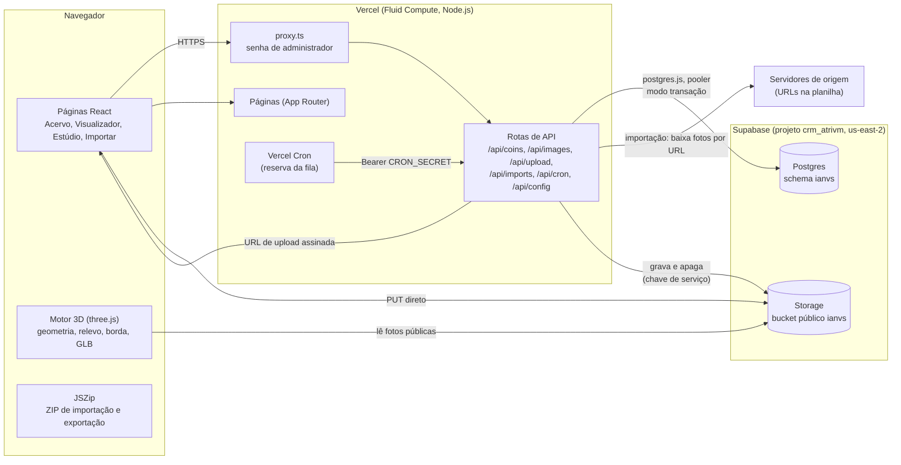
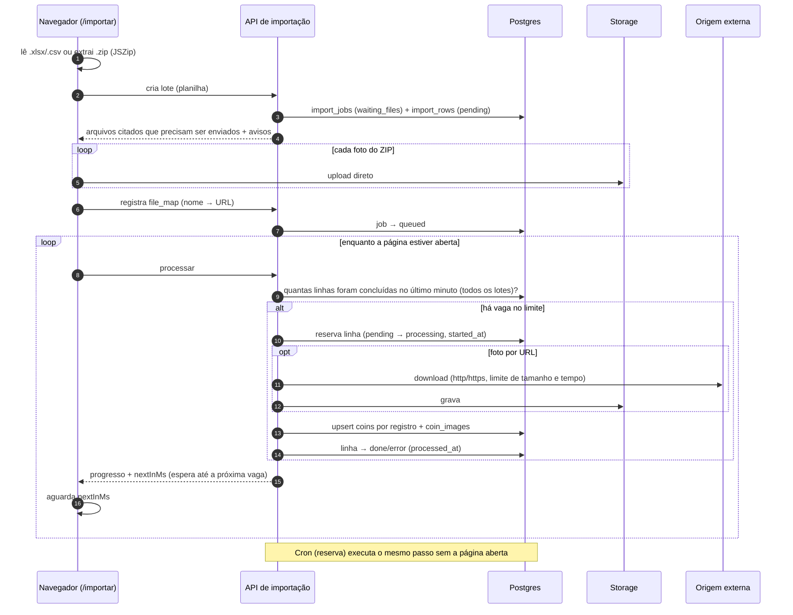
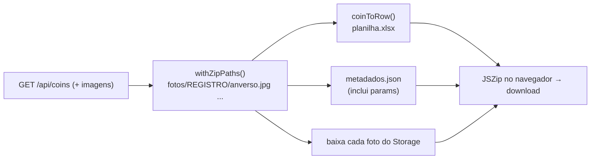

# 03 · Arquitetura

[Início](../README.md) · [Visão](01-visao-do-produto.md) · [Requisitos](02-requisitos-e-historias.md) · **Arquitetura** · [Dados](04-modelo-de-dados.md) · [Importação](05-importacao-por-planilha.md) · [Fotografia e relevo](06-guia-fotografico-e-relevo.md) · [Manual](07-manual-do-usuario.md) · [Deploy](08-deploy-na-vercel.md) · [Roadmap](09-roadmap.md) · [Glossário](glossario.md)

---

## Sumário

1. [Visão geral](#1-visão-geral)
2. [Componentes](#2-componentes)
3. [Rotas](#3-rotas)
4. [Fluxos](#4-fluxos)
5. [Motor 3D e relevo (navegador)](#5-motor-3d-e-relevo-navegador)
6. [Decisões de arquitetura (ADR)](#6-decisões-de-arquitetura-adr)
7. [Segurança](#7-segurança)
8. [Ambientes](#8-ambientes)

> **Situação do código em 24/11/2026.** Já existem: schema e conexão do banco, armazenamento, autenticação e `proxy.ts`, toda a API (moedas, imagens, upload, importação, cron, exportação de catálogo, configuração), o motor de geometria, relevo, borda e imagem (`src/lib/coin/`), a fila e o formato de planilha (`src/lib/import/`) e os componentes de palco 3D, disco de luz e janela Ajustar. As páginas estão em construção. Onde o texto descreve algo ainda não implementado, isso é indicado como **(previsto)**.

---

## 1. Visão geral



O banco do Supabase é **compartilhado com o CRM do ATRIVM**; o IANVS usa só o schema `ianvs`, que não é exposto pela Data API (PostgREST) do Supabase. O navegador nunca fala com o banco: todo acesso a dados passa pelas funções Next.js.

**Ideia central:** o servidor guarda e serve **dados** (ficha, parâmetros, endereços das imagens, fila). Todo o trabalho pesado sobre **pixels** no uso interativo (ajuste, recorte, relevo, malha 3D, `.glb`, ZIP) acontece no **navegador**. O servidor só toca em imagens na importação, quando precisa baixar uma foto citada por URL.

## 2. Componentes

| Camada | Tecnologia | Onde no código |
|---|---|---|
| Interface | Next.js 16 (App Router), React 19, Tailwind v4 | `src/app/`, `src/components/` |
| Motor 3D | three.js (npm), canvas 2D | `src/lib/coin/` (`geometry.ts`, `relief.ts`, `imaging.ts`, `edge.ts`) |
| Upload no cliente | `fetch` PUT na URL assinada do Supabase Storage (alternativa: `@vercel/blob/client`) | `src/lib/client/upload.ts` |
| Proteção de rotas | `proxy.ts` (sucessor do *middleware* no Next.js 16) | `src/proxy.ts`, `src/lib/auth.ts` |
| API | Route Handlers (runtime Node.js) | `src/app/api/**/route.ts` |
| Regras do acervo | Drizzle ORM | `src/lib/coins.ts` |
| Banco | Postgres do Supabase via postgres.js (`drizzle-orm/postgres-js`, pooler em modo transação, `prepare: false`), ou qualquer Postgres em `DATABASE_URL`; PGlite no dev | `src/lib/db/` |
| Migrações | drizzle-kit + `scripts/migrate.mjs` (conexão direta; controle de migrações no schema `ianvs`) | `drizzle/` |
| Arquivos | Supabase Storage (bucket público `ianvs`, `@supabase/supabase-js` com chave de serviço); alternativas: Vercel Blob ou disco em `.data/files` | `src/lib/storage.ts` |
| Planilhas | ExcelJS (servidor), CSV | `src/lib/import/` |
| ZIP | JSZip (navegador) | `src/lib/import/export-format.ts` |
| Imagem no servidor | sharp (dimensões das fotos baixadas na importação) | `src/lib/import/jobs.ts` |
| Validação | zod | rotas de API |

Pacotes nativos ou WASM (`@electric-sql/pglite`, `sharp`, `exceljs`) ficam fora do bundle do servidor (`serverExternalPackages` em `next.config.ts`).

## 3. Rotas

### 3.1 Páginas

| Rota | Acesso | Descrição |
|---|---|---|
| `/` | Público | Acervo |
| `/moeda/[id]` | Público | Visualizador em tela cheia |
| `/embed/[id]` | Público | Visualizador para `iframe` |
| `/estudio/[id]` | Admin | Estúdio de edição |
| `/importar` | Admin | Assistente de importação |
| `/entrar` | Público | Login |

### 3.2 API

| Método e rota | Acesso | Função | Situação |
|---|---|---|---|
| `GET /api/config` | Público | Modo de storage e banco, limite de importação, se há senha | Implementada |
| `POST /api/auth` | Público | Login (`{ password }`), grava cookie | Implementada |
| `DELETE /api/auth` | Público | Logout | Implementada |
| `GET /api/coins?q=&metal=&collection=&limit=&offset=` | Público | Lista (padrão 200 por página) | Implementada |
| `POST /api/coins` | Admin | Cria moeda; 409 se o registro já existe | Implementada |
| `GET /api/coins/[id]` | Público | Moeda com imagens | Implementada |
| `PATCH /api/coins/[id]` | Admin | Atualiza campos e `params`; 409 em registro duplicado | Implementada |
| `DELETE /api/coins/[id]` | Admin | Exclui moeda e arquivos | Implementada |
| `POST /api/coins/[id]/images` | Admin | Registra imagem já enviada ao storage | Implementada |
| `PATCH /api/images/[id]` | Admin | Altera azimute, elevação, ordem | Implementada |
| `DELETE /api/images/[id]` | Admin | Remove imagem e arquivo | Implementada |
| `POST /api/upload` | Admin | Supabase: recebe `{ pathname }` e devolve URL de upload assinada. Blob: emite token de *client upload*. Local: recebe o arquivo | Implementada |
| `GET /api/files/[...path]` | Público | Serve arquivos locais (só dev) | Implementada |
| `GET /api/imports/template` | Admin | Modelo de planilha `.xlsx` (abas Moedas e Instruções) | Implementada |
| `GET /api/imports` | Admin | 30 lotes mais recentes | Implementada |
| `POST /api/imports` | Admin | Cria lote a partir da planilha (multipart, ≤ 4 MB); devolve arquivos citados e avisos | Implementada |
| `GET /api/imports/[id]` | Admin | Progresso, contagens e linhas (paginado, filtro por status) | Implementada |
| `POST /api/imports/[id]/files` | Admin | Registra no lote os arquivos já enviados ao storage | Implementada |
| `POST /api/imports/[id]/start` | Admin | `waiting_files` → `queued` | Implementada |
| `POST /api/imports/[id]/process` | Admin | Um "tick" da fila (orçamento de 40 s, `maxDuration` 60 s) | Implementada |
| `POST /api/imports/[id]/cancel` | Admin | Cancela; pendentes viram `skipped` | Implementada |
| `POST /api/imports/[id]/retry` | Admin | Linhas com erro voltam à fila | Implementada |
| `GET /api/cron/imports` | Cron | Um tick para cada lote na fila (orçamento de 45 s) | Implementada |
| `GET /api/export/catalog.json?ids=` | Público (GET) | Catálogo com imagens e `zipPath`, para o navegador montar o ZIP | Implementada |
| `GET /api/export/catalog.xlsx?ids=` | Público (GET) | Planilha no formato de importação | Implementada |

Detalhes da API de importação em [05 · Importação](05-importacao-por-planilha.md#12-referência-da-api). Contratos de resposta em `src/lib/import/types.ts`.

## 4. Fluxos

### 4.1 Upload direto de fotos (Supabase Storage)

As funções da Vercel aceitam no máximo **4,5 MB** de corpo por requisição, e uma foto macro de moeda passa disso com facilidade (o bucket aceita até 50 MB por arquivo). Por isso o arquivo **não passa pela função**: a função só assina, e o navegador envia direto ao Storage.

```mermaid
sequenceDiagram
  autonumber
  participant N as Navegador (estúdio)
  participant P as proxy.ts
  participant U as /api/upload
  participant S as Supabase Storage
  participant I as /api/coins/[id]/images
  participant DB as Postgres (ianvs)

  N->>P: POST /api/upload { pathname }
  P->>P: cookie de administrador válido?
  P->>U: segue
  U->>U: nome único (sufixo aleatório); cria o bucket na 1ª vez
  U->>S: createSignedUploadUrl (chave de serviço)
  S-->>U: URL assinada + token
  U-->>N: { signedUrl, path, url pública }
  N->>S: PUT do arquivo na URL assinada (direto)
  S-->>N: 200
  N->>I: POST { face, kind, url, pathname, width, height, lightAz, lightEl }
  I->>DB: insert coin_images (photo/height substituem a anterior da face)
  I-->>N: imagem registrada
```

Sem Supabase e com `BLOB_READ_WRITE_TOKEN`, o mesmo papel é feito pelo *client upload* do Vercel Blob. Sem nenhum dos dois (dev), o navegador envia o corpo bruto para `POST /api/upload?pathname=...`, que grava em `.data/files`, e a URL resultante é `/api/files/...`. A troca é transparente: `GET /api/config` informa o modo, e `uploadFile()` escolhe o caminho.

### 4.2 Edição no estúdio

```mermaid
sequenceDiagram
  autonumber
  participant N as Navegador
  participant A as API
  participant B as Storage

  N->>A: GET /api/coins/[id]
  A-->>N: ficha + params + imagens (URLs)
  N->>B: baixa fotos (CORS anônimo)
  N->>N: processFace: ajuste, tom, máscara, contorno, luminância
  N->>N: relevo (auto, estéreo ou mapa) → altura + normais
  N->>N: buildCoinGeometry: espessura iterada até volume × densidade = peso
  N->>N: texturas de borda procedurais
  Note over N: o usuário ajusta controles; tudo é recalculado localmente
  N->>A: PATCH /api/coins/[id] { campos, params }
```

Os parâmetros do estúdio (ajustes de foto, relevo, borda, material) são salvos em `coins.params` (JSON). Os mapas calculados **não** são salvos: são recalculados a cada abertura a partir das fotos e dos parâmetros. Isso mantém a fonte de verdade nas fotos originais.

### 4.3 Importação em lote com fila



Pontos de projeto:

- **Limite global**: uma linha só é reservada se (linhas concluídas nos últimos 60 s, somando **todos** os lotes) + (linhas em processamento) < limite. A reserva é um único `UPDATE … WHERE id = (SELECT … FOR UPDATE SKIP LOCKED)`, portanto atômica. Dois lotes simultâneos dividem os mesmos 10 por minuto.
- **Dirigida pela página**: cada chamada processa linhas, uma de cada vez, por até 40 s (`maxDuration` de 60 s), bem abaixo do limite de duração das funções. A resposta informa `nextInMs`, e a página espera esse tempo antes de chamar de novo.
- **Cron como reserva**: mesmo passo, autenticado por `CRON_SECRET`. No plano Hobby o cron roda no máximo uma vez por dia, então serve só para "não deixar parado". No Pro pode rodar a cada minuto. Detalhes e contas em [05 · Importação](05-importacao-por-planilha.md#10-análise-de-viabilidade-do-lote-a-10-moedas-por-minuto).
- **Idempotência**: o upsert por registro faz com que reprocessar uma linha não duplique a moeda, e imagens já ligadas são reconhecidas pela URL. Linhas presas em `processing` há mais de 5 minutos (função encerrada no meio) voltam a `pending` no início de cada tick.

### 4.4 Exportação



O ZIP é montado no navegador para que nenhuma função precise juntar gigabytes de fotos (limites de memória, duração e corpo de resposta).

## 5. Motor 3D e relevo (navegador)

Resumo técnico; o lado numismático está em [06 · Guia fotográfico e relevo](06-guia-fotografico-e-relevo.md).

| Etapa | Função | O que faz |
|---|---|---|
| Posicionar a foto | `drawAdjusted` | Centro → giro → espelho → escala → deslocamento (mesma ordem do protótipo). O círculo inscrito no quadrado é a borda da moeda. |
| Tom | `applyTone` | Brilho e contraste por tabela, preservando o alfa. |
| Fundo | `estimateBackground`, `coinMask` | Mediana da cor da moldura externa (2,5%) da foto; inundação a partir das bordas por pixels transparentes ou próximos dessa cor (tolerância em fração da distância RGB máxima, padrão 0,18). Áreas escuras **dentro** da moeda não são apagadas. |
| Contorno | `radiusProfile` | Raio do flan em 256 ângulos, a partir da máscara. |
| Auto-centralizar | `autoFit` | Centroide da máscara e raio no percentil 98,5 da distância ao centro. |
| Relevo estimado | `reliefAuto` | Diferença entre um desfoque fino e um largo da luminância (passa-banda), com o raio largo controlado por **detalhe**. |
| Estéreo fotométrico | `reliefStereo` | Mínimos quadrados por pixel (Woodham, 1980) sobre intensidades linearizadas (gama 2,2). Com 4+ fotos descarta a medida mais escura (sombra); com 6+ também a mais clara (reflexo especular). Integração por Poisson multiescala (Gauss–Seidel, até 256×256) e remoção da "bacia" de baixa frequência. Também produz o **albedo**. |
| Mapa importado | `reliefFromHeightMap` | Luminância da imagem (claro = alto), com suavização pelo detalhe. |
| Normalização | `normalizeHeight`, `rimTaper` | Altura em −1…1 pelos percentis 2–98; o relevo some suavemente perto da borda. |
| Geometria | `makeGeometry`, `buildCoinGeometry` | Faces densas (96 anéis × 256 ângulos), afinamento do centro para a borda, borda em três faixas arredondadas. A espessura é **iterada** até que volume da malha × densidade = peso. A face é deslocada por altura × profundidade (pico a vale). |
| Borda | `buildEdgeTextures` | Cor do anel externo das duas faces + ruído procedural (pátina, depósitos terrosos, desgaste, cavidades). |

## 6. Decisões de arquitetura (ADR)

Formato curto: contexto, decisão, consequências.

### ADR-01 · Next.js 16 em Node.js

- **Contexto**: precisamos de páginas públicas rápidas, API simples, deploy sem servidor próprio e uma única linguagem para cliente e servidor (o motor 3D é TypeScript).
- **Decisão**: Next.js 16 (App Router, TypeScript) no runtime **Node.js** da Vercel (Fluid Compute). Não usar Edge runtime.
- **Consequências**: compartilhamento de tipos e de módulos (por exemplo, `src/lib/import/columns.ts` roda nos dois lados); acesso a bibliotecas Node (ExcelJS, sharp, PGlite) que não rodam no Edge; deploy de um único projeto. O Next.js 16 tem mudanças de API (por exemplo, `proxy.ts` no lugar de `middleware.ts`), e a equipe deve seguir a documentação da versão instalada.

### ADR-02 · Processamento de imagem e relevo no navegador

- **Contexto**: ajuste, recorte, relevo e malha precisam responder em tempo real a controles deslizantes. Fazer isso no servidor exigiria várias idas e voltas por ajuste, transferir fotos grandes repetidamente e pagar CPU por interação.
- **Decisão**: todo o processamento de pixels e de geometria roda no navegador (canvas 2D + three.js). O servidor guarda só fotos originais e parâmetros.
- **Consequências**: interação imediata e custo de servidor quase nulo. O `.glb` é gerado onde o modelo já existe. Em contrapartida, o desempenho depende do aparelho (o estéreo fotométrico com 8 fotos é o caso mais pesado), as fotos precisam de CORS liberado (as URLs públicas do Storage permitem) e os mapas são recalculados a cada abertura. Um cache de mapas calculados pode entrar depois (ver [Roadmap](09-roadmap.md)).

### ADR-03 · Supabase como provedor único de dados, com upload por URL assinada

*Substitui a decisão anterior (Neon + Vercel Blob), revista em 24/11/2026.*

- **Contexto**:
  - o ATRIVM já mantém um projeto Supabase (`crm_atrivm`, região `us-east-2`), vinculado à Vercel, usado pelo CRM;
  - as funções da Vercel limitam o corpo a 4,5 MB, e as fotos têm de 5 a 50 MB;
  - a importação em ZIP envolve centenas de fotos.
- **Decisão**:
  - um único provedor, o **Supabase**, para banco e arquivos;
  - **banco**: Postgres do Supabase, com todas as tabelas no schema próprio **`ianvs`** (inclusive o controle de migrações). As funções conectam pelo pooler em modo transação (`POSTGRES_URL`, `prepare: false`); as migrações, pela conexão direta (`POSTGRES_URL_NON_POOLING`);
  - **arquivos**: Supabase Storage, bucket **público** `ianvs`, criado pelo servidor no primeiro uso. `/api/upload` (só administradores) gera uma **URL de upload assinada** com a chave de serviço, e o navegador faz `PUT` direto. Gravação pelo servidor e exclusão usam a chave de serviço;
  - Vercel Blob e disco local continuam como alternativas no código.
- **Consequências**:
  - um painel, uma conta e uma integração, com as variáveis criadas pela integração Vercel–Supabase;
  - envio direto sem limite de corpo e sem custo de função proporcional ao tamanho;
  - o schema isolado não interfere no CRM e fica **fora da Data API** (PostgREST expõe `public`), então o acesso é só pelo servidor;
  - em contrapartida:
    - o IANVS divide com o CRM recursos, limites, backups e a **pausa por inatividade** do plano gratuito;
    - uma restauração do projeto afeta os dois sistemas;
    - previews e produção usam o mesmo banco, salvo configuração diferente;
    - a URL assinada em si não filtra tipo; quem filtra é o bucket, criado com `allowedMimeTypes: ["image/*"]` e limite de 50 MB;
    - o registro no banco é um passo separado (`POST /api/coins/[id]/images`), então um envio interrompido pode deixar arquivo órfão no bucket (ver [Roadmap](09-roadmap.md), limpeza de órfãos).

### ADR-04 · PGlite no desenvolvimento

- **Contexto**: queremos que qualquer pesquisador ou estudante rode o projeto com `npm install && npm run dev`, sem criar conta em serviços.
- **Decisão**: sem `DATABASE_URL` nem `POSTGRES_URL`, usar **PGlite** (Postgres compilado para WASM) em `.data/pglite`, com as mesmas migrações Drizzle (schema `ianvs`) aplicadas automaticamente na primeira conexão. Sem Supabase nem Blob, arquivos em `.data/files`.
- **Consequências**: mesmo dialeto SQL em dev e produção (é Postgres de verdade, não SQLite). PGlite é de processo único: não serve para produção nem para vários processos ao mesmo tempo. Em produção, uma URL de Postgres e um armazenamento externo são obrigatórios, já que o sistema de arquivos das funções não é persistente.

### ADR-05 · Fila com limite de taxa no próprio Postgres

- **Contexto**: a importação precisa de fila durável, retomável e com limite global por minuto. As opções incluíam um serviço de filas, Redis com limitador ou workflows duráveis.
- **Decisão**: tabelas `import_jobs` e `import_rows` no Postgres. O limite é verificado contando as linhas concluídas no último minuto. O processamento é dirigido pela página aberta e, como reserva, pelo cron.
- **Consequências**: nenhum serviço adicional para contratar, configurar ou pagar; estado da fila visível e auditável por SQL; funciona igual no PGlite. Em contrapartida, a vazão depende de alguém (página ou cron) chamar o processamento, a reserva de linhas é atômica (`FOR UPDATE SKIP LOCKED`) para evitar processamento duplo quando página e cron coincidem, e linhas interrompidas só voltam à fila depois de 5 minutos (recuperação por `started_at`). Para o volume esperado (até 5.000 linhas por lote, 10 por minuto) é suficiente. Se a vazão precisar crescer muito, a migração natural é para Vercel Queues ou Workflow, mantendo as mesmas tabelas como registro.

### ADR-06 · Parâmetros do estúdio em JSON

- **Contexto**: os controles do estúdio mudam com frequência durante o desenvolvimento.
- **Decisão**: guardar em `coins.params` (jsonb) e completar com os padrões atuais na leitura (`normalizeParams`).
- **Consequências**: novos controles não exigem migração; moedas antigas recebem padrões. Não dá para filtrar por esses campos com eficiência, o que não é um requisito.

### ADR-07 · Fotos públicas no Storage

- **Contexto**: o visualizador público e o `iframe` precisam carregar as fotos por CDN, e o motor precisa de CORS.
- **Decisão**: bucket público no Supabase Storage (`ianvs`), com sufixo aleatório no nome de cada arquivo e cache de 1 ano.
- **Consequências**: URLs difíceis de adivinhar, mas públicas para quem as tiver, **inclusive de moedas em rascunho**. Fotos com restrição de direitos de imagem não devem ser enviadas antes de acordo com a instituição detentora.

## 7. Segurança

### 7.1 Autenticação e autorização

- **Senha única** (`ADMIN_PASSWORD`). `POST /api/auth` compara a senha e grava o cookie `ianvs_admin` com `SHA-256("ianvs:" + senha)` em base64url: `httpOnly`, `sameSite=lax`, `secure` em produção, validade de 30 dias.
- `proxy.ts` protege `/estudio/**`, `/importar/**`, `/api/imports/**`, `/api/upload`, `/api/cron/**` e **qualquer método diferente de GET/HEAD** em `/api/**`. Páginas redirecionam para `/entrar?next=...`; a API responde 401.
- `/api/cron/**` aceita `Authorization: Bearer <CRON_SECRET>` quando a variável está definida; sem ela, exige sessão de administrador.

### 7.2 Limitações conhecidas e mitigações

| Ponto | Risco | Mitigação |
|---|---|---|
| Sem `ADMIN_PASSWORD` | Tudo aberto para escrita | Obrigatório definir em produção (checklist do [deploy](08-deploy-na-vercel.md)) |
| Sem `CRON_SECRET` | `/api/cron/**` passa a exigir sessão de administrador, e o cron da Vercel não consegue entrar (se também não houver `ADMIN_PASSWORD`, a rota fica aberta) | Definir `CRON_SECRET` em produção |
| Token derivado só da senha | Não expira no servidor nem pode ser revogado individualmente; trocar a senha derruba todas as sessões | Aceitável para equipe pequena; contas individuais no [roadmap](09-roadmap.md) |
| Força bruta em `/api/auth` | Tentativas ilimitadas | Senha longa; regra de limite de taxa no Vercel Firewall para `POST /api/auth` |
| Leitura pública da API | `GET /api/coins`, `GET /api/coins/[id]` e `GET /api/export/catalog.*` não filtram rascunhos hoje (o `proxy.ts` só protege escrita e as rotas listadas acima). O catálogo inclui observações internas (`notes`) | Filtrar `status = published` e omitir `notes` para quem não é administrador (RF-06), ou proteger `/api/export/**` |
| Download por URL na importação | SSRF: a planilha pode apontar para endereços internos | Implementado em `src/lib/import/jobs.ts`: só `http`/`https`; em produção recusa `localhost`, `.local`, `.internal`, redes privadas, *link-local* e CGNAT pelo nome do host; *timeout* de 20 s; máx. 40 MB; exige `image/*`. Limitação: a verificação é pelo nome do host, sem resolver DNS, e redirecionamentos são seguidos sem nova verificação |
| Fotos públicas no Storage | URL vazada expõe foto de rascunho | Ver ADR-07; bucket privado com URLs assinadas de leitura, se necessário, no futuro |
| Chave de serviço do Supabase | Dá acesso total ao projeto, **inclusive ao CRM** | Só em variável de servidor (`SUPABASE_SERVICE_ROLE_KEY`), nunca `NEXT_PUBLIC_*`; usada apenas em `src/lib/storage.ts` |
| Banco compartilhado com o CRM | Migração ou consulta errada pode afetar dados do CRM | Tudo qualificado no schema `ianvs` (inclusive SQL bruto da fila); migrações revisadas; considerar um usuário Postgres com permissão só em `ianvs` |
| Data API do Supabase | Exposição das tabelas pela API REST | O schema `ianvs` não é exposto; não incluí-lo nos schemas da Data API |
| Tipos de arquivo no upload assinado | A URL assinada não filtra tipo | O bucket só aceita `image/*`, até 50 MB por arquivo |
| `/embed/[id]` em `iframe` | *Clickjacking* nas demais páginas | Permitir `frame-ancestors` só em `/embed/**`; negar nas demais |
| Upload | Tipos inesperados | Lista de tipos e tamanho validados no token (`onBeforeGenerateToken`) |
| Caminhos locais | *Path traversal* em `/api/files` | `readLocal` confere que o caminho resolvido está dentro de `.data/files`; `safePathname` limpa nomes |

### 7.3 Dados pessoais

O acervo não guarda dados pessoais além de eventuais nomes em campos de texto livre (por exemplo, doador em observações). Não há cadastro de usuários. Os logs da Vercel registram IPs de acesso conforme a política da plataforma.

## 8. Ambientes

| | Desenvolvimento local | Produção (Vercel) |
|---|---|---|
| Banco | PGlite em `.data/pglite` (migra sozinho) | Supabase Postgres, schema `ianvs` (pooler nas funções; conexão direta nas migrações do build) |
| Arquivos | `.data/files`, servidos por `/api/files` | Supabase Storage, bucket público `ianvs` |
| Upload | Corpo bruto para `/api/upload` | PUT direto na URL assinada do Storage |
| Senha | Opcional | Obrigatória (recomendação) |
| Fila | Página aberta | Página aberta + cron |

Também é possível rodar localmente contra os serviços reais: `vercel env pull .env.local` e `npm run dev`. Atenção: isso usa o banco e o bucket reais, compartilhados com o CRM.

---

← [02 · Requisitos](02-requisitos-e-historias.md) · Próximo: [04 · Modelo de dados →](04-modelo-de-dados.md)
