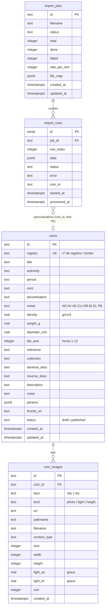
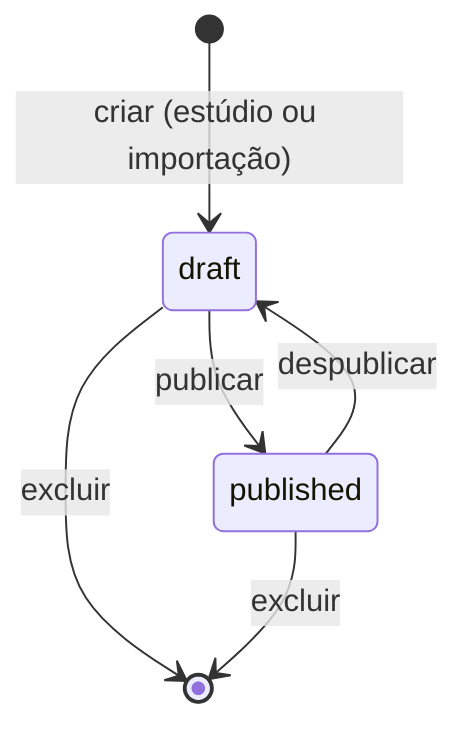
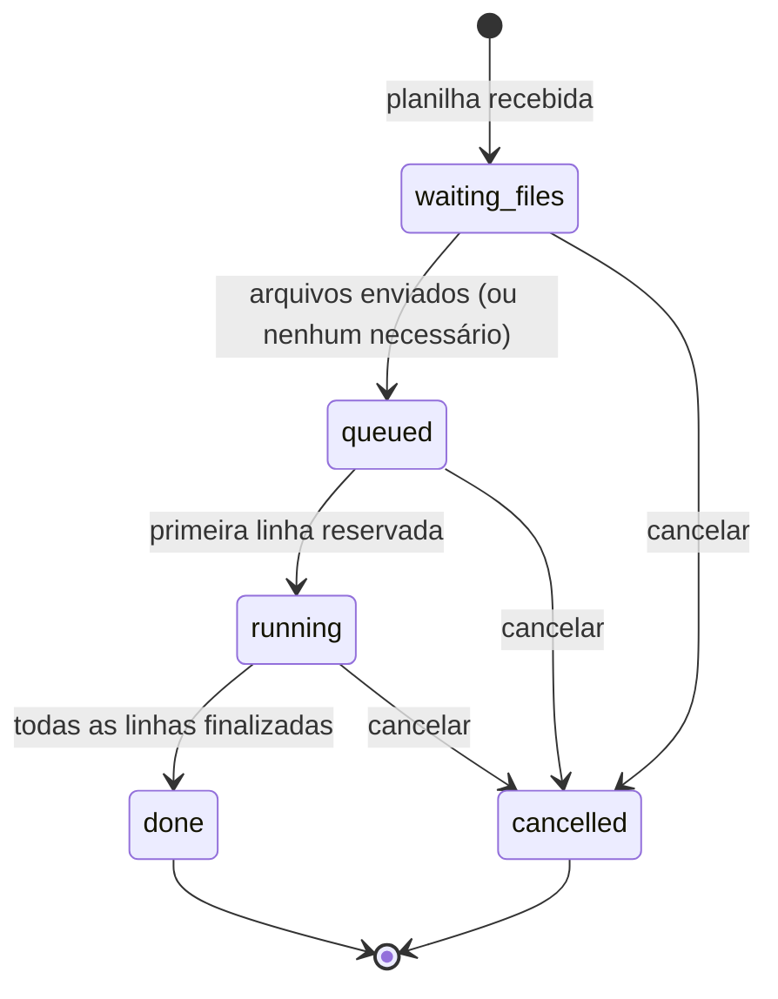
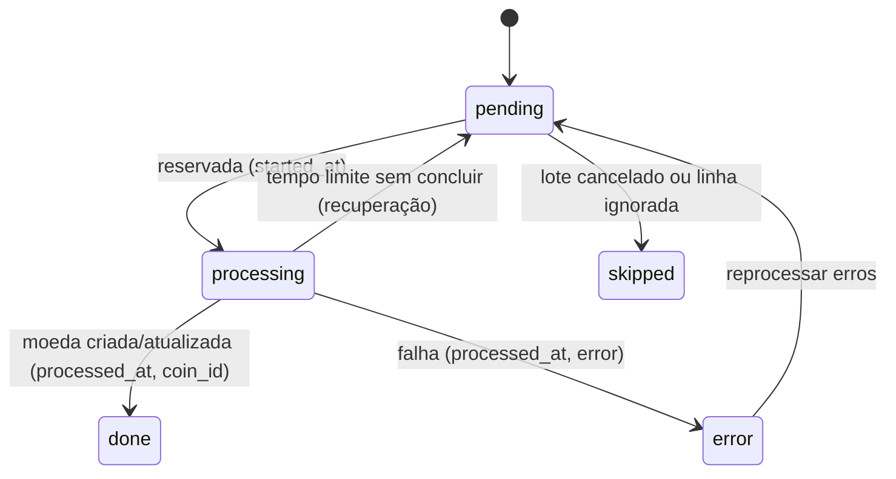

# 04 · Modelo de dados

[Início](../README.md) · [Visão](01-visao-do-produto.md) · [Requisitos](02-requisitos-e-historias.md) · [Arquitetura](03-arquitetura.md) · **Dados** · [Importação](05-importacao-por-planilha.md) · [Fotografia e relevo](06-guia-fotografico-e-relevo.md) · [Manual](07-manual-do-usuario.md) · [Deploy](08-deploy-na-vercel.md) · [Roadmap](09-roadmap.md) · [Glossário](glossario.md)

---

## Sumário

1. [Visão geral](#1-visão-geral)
2. [Diagrama ER](#2-diagrama-er)
3. [Tabela `coins`](#3-tabela-coins)
4. [Tabela `coin_images`](#4-tabela-coin_images)
5. [Tabela `import_jobs`](#5-tabela-import_jobs)
6. [Tabela `import_rows`](#6-tabela-import_rows)
7. [Estrutura de `coins.params`](#7-estrutura-de-coinsparams)
8. [Metais e densidades](#8-metais-e-densidades)
9. [Ciclos de vida](#9-ciclos-de-vida)
10. [Migrações](#10-migrações)

Fonte da verdade: `src/lib/db/schema.ts` (Drizzle) e `src/lib/types.ts`. Migração inicial: `drizzle/0000_init.sql`.

> **Schema `ianvs`.** Todas as tabelas ficam no schema Postgres **`ianvs`** (`pgSchema("ianvs")` no Drizzle; a migração inicial executa `CREATE SCHEMA "ianvs"`). Em produção, o banco é o Postgres do projeto Supabase `crm_atrivm`, **compartilhado com o CRM do ATRIVM**, cujo schema `public` o IANVS não toca. O schema `ianvs` não é exposto pela Data API (PostgREST) do Supabase: as tabelas são lidas e escritas só pelo servidor Next.js. Os nomes completos são `ianvs.coins`, `ianvs.coin_images`, `ianvs.import_jobs` e `ianvs.import_rows`, e o SQL bruto da fila (`src/lib/import/jobs.ts`) já os usa qualificados.

---

## 1. Visão geral

| Tabela | Papel |
|---|---|
| `coins` | Uma linha por moeda: ficha catalográfica, dimensões, status e parâmetros do estúdio (`params`) |
| `coin_images` | Arquivos de cada moeda: foto principal, fotos de luz direcional e mapa de altura, por face |
| `import_jobs` | Um lote de importação (planilha), com progresso e mapa de arquivos enviados |
| `import_rows` | Uma linha da planilha por registro, com seu estado na fila |

Convenções:

- Schema `ianvs` em todos os ambientes (Supabase e PGlite).

- Identificadores de `coins`, `coin_images` e `import_jobs` são textos curtos aleatórios (`nanoid`, 12 caracteres). `import_rows.id` é `serial`.
- Datas são `timestamp with time zone`, preenchidas pelo banco (`now()`).
- Nomes de colunas em `snake_case` no banco e em `camelCase` no TypeScript (`weight_g` ↔ `weightG`).
- Os valores enumerados (status, face, tipo) são `text` validados pela aplicação, não `enum` do Postgres.

## 2. Diagrama ER



## 3. Tabela `coins`

| Coluna | Tipo | Nulo | Padrão | Descrição |
|---|---|---|---|---|
| `id` | text | não | — | Identificador (PK) |
| `registry` | text | sim | — | Nº de registro ou tombo. **Único** (`coins_registry_idx`). Chave do upsert da importação. Vários `NULL` são permitidos. |
| `title` | text | não | `'Nova moeda'` | Título exibido |
| `authority` | text | sim | — | Autoridade emissora |
| `period` | text | sim | — | Datação, texto livre ("c. 2 a.C. – 4 d.C.") |
| `mint` | text | sim | — | Casa monetária ou oficina |
| `denomination` | text | sim | — | Denominação (denário, sestércio, tetradracma…) |
| `metal` | text | sim | — | Sigla: `AR`, `AV`, `AE`, `CU`, `OR`, `BI`, `EL`, `PB` |
| `density` | real | não | `10.5` | Densidade usada no cálculo da espessura, g/cm³ |
| `weight_g` | real | sim | — | Peso em gramas |
| `diameter_mm` | real | sim | — | Diâmetro em milímetros (um único valor; ver nota) |
| `die_axis` | integer | sim | — | Eixo dos cunhos em horas (1 a 12) |
| `reference` | text | sim | — | Referência bibliográfica (RIC, RPC, Crawford…) |
| `collection` | text | sim | — | Acervo ou coleção |
| `obverse_desc` | text | sim | — | Descrição do anverso (legenda e tipo) |
| `reverse_desc` | text | sim | — | Descrição do reverso |
| `description` | text | sim | — | Texto livre exibido na legenda |
| `notes` | text | sim | — | Observações internas |
| `params` | jsonb | sim | — | Parâmetros do estúdio (seção 7). `NULL` é completado com os padrões na leitura |
| `thumb_url` | text | sim | — | Miniatura usada na grade do acervo |
| `status` | text | não | `'draft'` | `draft` (rascunho) ou `published` (publicado) |
| `created_at` | timestamptz | não | `now()` | Criação |
| `updated_at` | timestamptz | não | `now()` | Última alteração (também atualizada ao adicionar imagem). Índice `coins_updated_idx` para ordenar o acervo |

> **Nota sobre o diâmetro.** O campo guarda **um** número. Para moedas com diâmetro variável (flan irregular, por exemplo 18,5–19,1 mm), registre o valor médio (18,8) em `diameter_mm` e a faixa medida em `notes`. O modelo 3D usa o **contorno real** da foto, escalado para que o raio médio corresponda ao diâmetro informado.

Regras aplicadas por `sanitizeFields` (em `src/lib/coins.ts`):

- Textos são aparados; texto vazio vira `NULL`.
- Números aceitam vírgula decimal. Valores ilegíveis viram `NULL`.
- `metal` fora da lista vira `NULL`.
- `die_axis` é arredondado para inteiro.
- `status` só aceita `draft` ou `published`.
- Título vazio vira "Sem título".

## 4. Tabela `coin_images`

| Coluna | Tipo | Nulo | Padrão | Descrição |
|---|---|---|---|---|
| `id` | text | não | — | PK |
| `coin_id` | text | não | — | FK → `coins.id`, **`ON DELETE CASCADE`**. Índice `coin_images_coin_idx` |
| `face` | text | não | — | `obv` (anverso) ou `rev` (reverso) |
| `kind` | text | não | — | `photo` (foto principal), `light` (foto com luz direcional) ou `height` (mapa de altura) |
| `url` | text | não | — | URL pública do Supabase Storage (`https://<projeto>.supabase.co/storage/v1/object/public/ianvs/...`), do Vercel Blob (alternativa) ou `/api/files/...` (local) |
| `pathname` | text | não | — | Caminho no storage |
| `filename` | text | sim | — | Nome original do arquivo |
| `content_type` | text | sim | — | Tipo MIME |
| `size` | integer | sim | — | Bytes |
| `width`, `height` | integer | sim | — | Dimensões em pixels |
| `light_az` | real | sim | — | Azimute da luz, em graus, **na foto original**: 0° = luz vindo da direita, 90° = de cima, sentido anti-horário. Só para `light` |
| `light_el` | real | sim | — | Elevação da luz acima do plano da moeda, em graus. Só para `light` |
| `sort` | integer | não | `0` | Ordem de exibição |
| `created_at` | timestamptz | não | `now()` | — |

Cardinalidade por face:

| `kind` | Quantas por face | Ao enviar outra |
|---|---|---|
| `photo` | 0 ou 1 | Substitui (a anterior é apagada do banco e do storage) |
| `height` | 0 ou 1 | Substitui |
| `light` | 0 a n (recomendado 4 a 8) | Acrescenta |

Excluir uma moeda apaga as linhas de `coin_images` pelo `CASCADE`, e `deleteCoin` apaga antes os arquivos no storage.

## 5. Tabela `import_jobs`

| Coluna | Tipo | Nulo | Padrão | Descrição |
|---|---|---|---|---|
| `id` | text | não | — | PK |
| `filename` | text | não | — | Nome da planilha ou ZIP enviado |
| `status` | text | não | `'waiting_files'` | Ver ciclo de vida (seção 9) |
| `total` | integer | não | `0` | Linhas do lote |
| `done` | integer | não | `0` | Linhas concluídas com sucesso |
| `failed` | integer | não | `0` | Linhas com erro |
| `rate_per_min` | integer | não | `10` | Limite registrado no momento da criação (de `IMPORT_RATE_PER_MIN`) |
| `file_map` | jsonb | não | `{}` | Arquivos já enviados ao storage, por nome normalizado (abaixo) |
| `created_at`, `updated_at` | timestamptz | não | `now()` | — |

Formato de `file_map`:

```json
{
  "fotos/155933/anverso.jpg": {
    "url": "https://<projeto>.supabase.co/storage/v1/object/public/ianvs/imports/.../anverso-x1y2.jpg",
    "pathname": "imports/.../anverso-x1y2.jpg",
    "size": 3145728,
    "contentType": "image/jpeg",
    "width": 4000,
    "height": 4000
  }
}
```

A chave é o caminho normalizado (sem acentos, minúsculo, `/` como separador). `width` e `height` são opcionais e, quando medidos no navegador, evitam que o servidor baixe a foto de novo.

## 6. Tabela `import_rows`

| Coluna | Tipo | Nulo | Padrão | Descrição |
|---|---|---|---|---|
| `id` | serial | não | — | PK |
| `job_id` | text | não | — | FK → `import_jobs.id`, `ON DELETE CASCADE` |
| `row_index` | integer | não | — | Número da linha na planilha (para mensagens ao usuário) |
| `data` | jsonb | não | — | Células da linha, com chaves canônicas (`registro`, `titulo`, `peso_g`…; ver [05](05-importacao-por-planilha.md)) |
| `status` | text | não | `'pending'` | `pending`, `processing`, `done`, `error` ou `skipped` |
| `error` | text | sim | — | Mensagem de erro legível |
| `coin_id` | text | sim | — | Moeda criada ou atualizada (sem FK, para que excluir a moeda não apague o histórico do lote) |
| `started_at` | timestamptz | sim | — | Quando a linha foi reservada para processamento |
| `processed_at` | timestamptz | sim | — | Quando terminou (sucesso ou erro) |

Índices:

- `import_rows_job_idx (job_id, status)`: buscar a próxima linha pendente de um lote e contar por status.
- `import_rows_processed_idx (processed_at)`: contar quantas linhas terminaram no último minuto, em todos os lotes. É a base do **limite global de taxa**.

## 7. Estrutura de `coins.params`

Tipo `CoinParams` em `src/lib/types.ts`. Sempre lido através de `normalizeParams`, que completa campos ausentes com os padrões vigentes.

```jsonc
{
  "edgeRatio": 0.8,        // espessura na borda ÷ espessura no centro
  "roundness": 0.6,        // arredondamento da borda
  "brightness": 1,         // brilho do material
  "metalness": 0.55,       // padrão do metal (AR)
  "roughness": 0.45,       // padrão do metal (AR)
  "edgeColor": null,       // null = automático (cor do anel externo das fotos); ou "#8a7350"
  "adjust": {              // posicionamento da foto principal em cada face (janela Ajustar)
    "obv": {
      "scale": 1,          // 0,4 – 3
      "dx": 0,             // deslocamento horizontal, em frações do menor lado da foto
      "dy": 0,             // deslocamento vertical
      "rot": 0,            // graus
      "mirror": false,
      "brightness": 1,     // 1 = original
      "contrast": 1,       // 1 = original
      "cutout": { "enabled": false, "tolerance": 0.18 } // recorte automático do fundo
    },
    "rev": { "...": "mesma estrutura" }
  },
  "relief": {              // relevo por face
    "obv": {
      "mode": "auto",      // "off" | "auto" | "stereo" | "height"
      "strength": 1,       // intensidade do mapa de normais, 0 – 3
      "depthMm": 0.25,     // profundidade geométrica real, pico a vale, 0 – 1 mm
      "detail": 4,         // escala do detalhe, 1 – 12 (maior = formas maiores)
      "invert": false
    },
    "rev": { "...": "mesma estrutura" }
  }
}
```

| Campo | Faixa | Padrão | Efeito |
|---|---|---|---|
| `edgeRatio` | 0–1 (sugerida) | 0,8 | Quanto a borda é mais fina que o centro |
| `roundness` | 0–1 (sugerida) | 0,6 | Largura do arredondamento da borda |
| `brightness` | — | 1 | Multiplicador de brilho do material |
| `metalness`, `roughness` | 0–1 | do metal | Aparência PBR |
| `edgeColor` | cor ou `null` | `null` | Cor-base da borda |
| `adjust.*.scale` | 0,4–3 | 1 | Escala da foto sob a guia |
| `adjust.*.dx`, `dy` | — | 0 | Deslocamento |
| `adjust.*.rot` | graus | 0 | Giro |
| `adjust.*.cutout.tolerance` | 0–1 | 0,18 | Fração da distância RGB máxima considerada "fundo" |
| `relief.*.mode` | enum | `auto` | Fonte do relevo |
| `relief.*.strength` | 0–3 | 1 | Intensidade do *normal map* |
| `relief.*.depthMm` | 0–1 mm | 0,25 | Deslocamento real da malha |
| `relief.*.detail` | 1–12 | 4 | Raio do filtro (Estimado) ou suavização (Fotométrico, Mapa) |
| `relief.*.invert` | bool | `false` | Inverte altos e baixos |

Os **ajustes de foto** valem para a foto principal e também para as fotos de luz e o mapa de altura da mesma face. Por isso, fotos de luz devem ter **o mesmo enquadramento** da foto principal (câmera fixa). O azimute gravado em `coin_images.light_az` é o da foto original; o motor o corrige pelo giro e espelhamento do ajuste.

## 8. Metais e densidades

Constante `METALS` em `src/lib/types.ts`. A densidade é sugerida ao escolher o metal e pode ser sobrescrita por moeda.

| Sigla | Metal | Densidade (g/cm³) | Metalicidade | Rugosidade |
|---|---|---|---|---|
| AR | Prata | 10,5 | 0,55 | 0,45 |
| AV | Ouro | 19,3 | 0,80 | 0,30 |
| AE | Bronze | 8,8 | 0,35 | 0,70 |
| CU | Cobre | 8,9 | 0,35 | 0,70 |
| OR | Oricalco | 8,4 | 0,40 | 0,65 |
| BI | Bilhão | 9,6 | 0,45 | 0,60 |
| EL | Eletro | 15,5 | 0,70 | 0,35 |
| PB | Chumbo | 11,3 | 0,20 | 0,80 |

Bilhão e eletro são ligas de composição variável; os valores são médias de trabalho. Quando houver análise de composição da peça, informe a densidade medida.

## 9. Ciclos de vida

### 9.1 Moeda



### 9.2 Lote de importação



### 9.3 Linha de importação



## 10. Migrações

- Gerar após alterar `schema.ts`: `npx drizzle-kit generate` (cria um novo `drizzle/000N_*.sql`).
- **Produção**: o build roda `node scripts/migrate.mjs && next build` (ver [deploy](08-deploy-na-vercel.md#8-migrações-no-build)).
  - O script usa a **conexão direta** do Supabase: `DATABASE_URL_UNPOOLED`, senão `POSTGRES_URL_NON_POOLING`, senão `DATABASE_URL`, senão `POSTGRES_URL`.
  - A tabela de controle das migrações do Drizzle também fica no schema `ianvs` (`migrationsSchema: "ianvs"`).
  - Sem URL de banco, o script não faz nada.
- **Dev**: o PGlite aplica as migrações sozinho na primeira conexão (`src/lib/db/index.ts`).
- Nunca edite uma migração já aplicada em produção; crie uma nova.
- Toda migração deve ficar restrita ao schema `ianvs`: o banco é compartilhado com o CRM.

---

← [03 · Arquitetura](03-arquitetura.md) · Próximo: [05 · Importação por planilha →](05-importacao-por-planilha.md)
