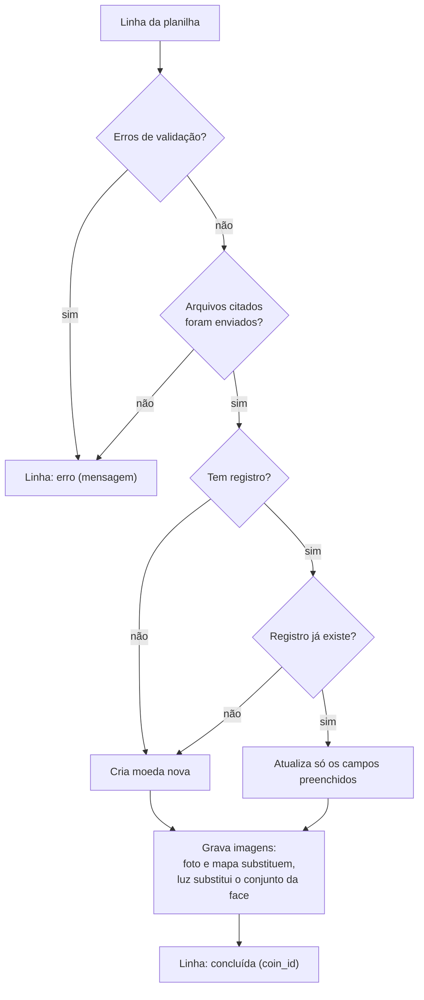

# 05 · Importação por planilha

[Início](../README.md) · [Visão](01-visao-do-produto.md) · [Requisitos](02-requisitos-e-historias.md) · [Arquitetura](03-arquitetura.md) · [Dados](04-modelo-de-dados.md) · **Importação** · [Fotografia e relevo](06-guia-fotografico-e-relevo.md) · [Manual](07-manual-do-usuario.md) · [Deploy](08-deploy-na-vercel.md) · [Roadmap](09-roadmap.md) · [Glossário](glossario.md)

---

## Sumário

1. [Resumo](#1-resumo)
2. [Formatos aceitos](#2-formatos-aceitos)
3. [Colunas](#3-colunas)
4. [Valores: números, metal, eixo, status](#4-valores-números-metal-eixo-status)
5. [Fotos: URL, nome de arquivo ou ZIP](#5-fotos-url-nome-de-arquivo-ou-zip)
6. [Luz direcional](#6-luz-direcional)
7. [Upsert por registro](#7-upsert-por-registro)
8. [Como a fila funciona](#8-como-a-fila-funciona)
9. [Erros comuns](#9-erros-comuns)
10. [Análise de viabilidade do lote a 10 moedas por minuto](#10-análise-de-viabilidade-do-lote-a-10-moedas-por-minuto)
11. [Exportação e ida e volta](#11-exportação-e-ida-e-volta)
12. [Referência da API](#12-referência-da-api)

Exemplo pronto: [`exemplos/planilha-exemplo.csv`](exemplos/planilha-exemplo.csv) (separador vírgula, decimais com ponto; três moedas: Denário de Augusto, sestércio e tetradracma). As fotos citadas não acompanham o exemplo: envie arquivos de teste com esses nomes. As URLs de `exemplo.org` da segunda linha são fictícias e servem para ver como o sistema registra um erro de download. Modelo oficial com instruções: `GET /api/imports/template` (botão **Baixar modelo** em `/importar`).

---

## 1. Resumo

- **Uma moeda por linha**, cabeçalho na primeira linha.
- Os nomes das colunas não diferenciam maiúsculas, acentos nem espaços (`Título`, `TITULO` e `titulo` valem; `Peso (g)` vira `peso_g`). Há sinônimos (`tombo` = `registro`, `oficina` = `casa_monetaria`…).
- Cada linha precisa de **`titulo` ou `registro`**. Linhas sem os dois são ignoradas com aviso.
- **Até 5.000 moedas** por planilha e **até 4 MB** por arquivo de planilha (as fotos vão à parte).
- Se o **registro** já existir, a moeda é **atualizada**. Células vazias **não apagam** dados existentes.
- O processamento é **em fila**, com limite global de **10 moedas por minuto** (`IMPORT_RATE_PER_MIN`).

## 2. Formatos aceitos

| Formato | Observações |
|---|---|
| `.xlsx` | Usa a aba chamada **Moedas**, se existir; senão a primeira aba com cabeçalho reconhecível. Abas cujo nome contém "Instru" são ignoradas. Fórmulas são lidas pelo resultado. Hiperlinks em células de foto são usados como URL. |
| `.csv` | Separador detectado na primeira linha: `;` (padrão do Excel em português), `,` ou tabulação. Aspas duplas para campos com separador ou quebra de linha (RFC 4180). Codificação UTF-8 ou Windows-1252 (detectada). |
| `.zip` | Planilha (`.xlsx` ou `.csv`) + fotos, em qualquer estrutura de pastas. O ZIP é aberto **no navegador**; a planilha vai para o servidor e as fotos vão direto para o armazenamento. |
| Planilha + fotos avulsas | Selecione a planilha e as fotos (ou uma pasta) na página de importação. |
| `.xls` | **Não aceito**. Salve como `.xlsx` ou `.csv`. |

O cabeçalho é procurado nas primeiras 20 linhas: vale a primeira linha com ao menos 3 colunas reconhecidas (ou 2, se uma delas for `titulo` ou `registro`). Colunas não reconhecidas são ignoradas e listadas nos avisos. Colunas repetidas também: vale a primeira.

## 3. Colunas

Todas são opcionais, exceto que cada linha precisa de `titulo` ou `registro`.

### 3.1 Ficha

| Coluna | Sinônimos aceitos (exemplos) | Campo | Exemplo | Regras |
|---|---|---|---|---|
| `registro` | `tombo`, `n_registro`, `inventario` | `registry` | `155933` | Identificador da moeda no acervo. Chave do upsert. Máx. 120 caracteres. |
| `titulo` | `nome`, `title`, `identificacao` | `title` | `Denário de Augusto` | Máx. 300 caracteres. Sem título, a moeda nova recebe "Moeda <registro>". |
| `autoridade` | `emissor`, `imperador`, `governante` | `authority` | `Augusto` | Texto livre. |
| `periodo` | `data`, `datacao`, `cronologia` | `period` | `27 a.C. – 14 d.C.` | Texto livre. |
| `casa_monetaria` | `oficina`, `casa_da_moeda`, `mint` | `mint` | `Roma` | Texto livre. |
| `denominacao` | `valor`, `nominal`, `tipo` | `denomination` | `Denário` | Texto livre. |
| `metal` | `material`, `liga` | `metal` | `AR` | Sigla ou nome (seção 4). |
| `densidade` | `densidade_g_cm3` | `density` | `10,5` | g/cm³, entre 0 e 30. Vazia: densidade típica do metal. |
| `peso_g` | `peso`, `massa`, `weight` | `weight_g` | `3,8` | Gramas, entre 0 e 5.000. |
| `diametro_mm` | `diametro`, `modulo` | `diameter_mm` | `18,8` | Milímetros, entre 0 e 500. **Um único valor** (ver nota). |
| `eixo` | `eixo_cunhos`, `eixo_dos_cunhos`, `die_axis` | `die_axis` | `6` ou `6h` | Horas, 1 a 12 (0 vira 12). |
| `referencia` | `ref`, `bibliografia`, `catalogo` | `reference` | `RIC I² 126` | Texto livre. |
| `acervo` | `colecao`, `instituicao`, `museu` | `collection` | `Museu Histórico Nacional` | Texto livre; usado no filtro do acervo. |
| `anverso_descricao` | `anverso`, `descricao_anverso` | `obverse_desc` | `Cabeça laureada à direita…` | Legenda e tipo. |
| `reverso_descricao` | `reverso`, `descricao_reverso` | `reverse_desc` | `Coruja à direita…` | Legenda e tipo. |
| `descricao` | `legenda`, `texto` | `description` | — | Texto livre exibido na legenda do visualizador. |
| `observacoes` | `obs`, `notas` | `notes` | `Diâmetro medido: 18,5–19,1 mm` | Observações internas. |
| `status` | `situacao`, `publicacao` | `status` | `rascunho` | Seção 4. |

> **Faixas de medida.** `diametro_mm` aceita um número só. "18,5–19,1" é recusado como inválido. Informe a média (18,8) e anote a faixa em `observacoes`.

### 3.2 Imagens

| Coluna | Sinônimos (exemplos) | Face e tipo | Exemplo |
|---|---|---|---|
| `foto_anverso` | `imagem_anverso`, `foto_frente` | anverso, foto principal | `155933_anv.jpg` ou `https://…/155933_anv.jpg` |
| `foto_reverso` | `imagem_reverso`, `foto_verso` | reverso, foto principal | `155933_rev.jpg` |
| `luz_anverso` | `fotos_luz_anverso`, `rti_anverso` | anverso, fotos com luz direcional | `155933_anv_luz000.jpg@0; 155933_anv_luz090.jpg@90; …` |
| `luz_reverso` | `fotos_luz_reverso`, `rti_reverso` | reverso, fotos com luz direcional | idem |
| `relevo_anverso` | `mapa_altura_anverso`, `heightmap_anverso` | anverso, mapa de altura | `155933_anv_altura.png` |
| `relevo_reverso` | `mapa_altura_reverso`, `heightmap_reverso` | reverso, mapa de altura | `155933_rev_altura.png` |

A lista completa de sinônimos está em `src/lib/import/columns.ts` e na aba **Instruções** do modelo.

## 4. Valores: números, metal, eixo, status

**Números.** Aceitam vírgula ou ponto decimal (`3,8`, `3.8`); com os dois, o último é o decimal (`1.234,5`). Unidades no fim são toleradas (`3,8 g`, `18,8mm`). Zero, negativo ou acima do limite gera erro na linha.

**Metal.** Sigla ou nome, sem diferenciar maiúsculas e acentos:

| Valor na planilha | Resultado | Densidade sugerida |
|---|---|---|
| `AR`, `prata`, `silver`, `argentum` | AR | 10,5 |
| `AV`, `AU`, `ouro`, `gold`, `aurum` | AV | 19,3 |
| `AE`, `Æ`, `bronze` | AE | 8,8 |
| `CU`, `cobre`, `copper` | CU | 8,9 |
| `OR`, `oricalco`, `orichalcum`, `latão` | OR | 8,4 |
| `BI`, `bilhão`, `billon` | BI | 9,6 |
| `EL`, `eletro`, `electrum` | EL | 15,5 |
| `PB`, `chumbo`, `lead` | PB | 11,3 |

Também se reconhece a sigla entre parênteses ("Prata (AR)") ou a primeira palavra ("bronze dourado" → AE). Quando `densidade` está vazia, usa-se a do metal.

**Eixo.** Inteiro de 1 a 12, com ou sem "h" (`6`, `6h`, `6 horas`). `0` é lido como 12.

**Status.**

| Aceitos | Resultado |
|---|---|
| `rascunho`, `draft`, `não`, `n`, `0`, `privado`, `oculto` | Rascunho |
| `publicado`, `publicada`, `published`, `público`, `sim`, `s`, `1`, `visível` | Publicado |
| vazio | Moeda nova: rascunho. Moeda existente: mantém o status. |

## 5. Fotos: URL, nome de arquivo ou ZIP

Cada célula de foto pode conter:

1. **Uma URL** `http://` ou `https://`. O servidor baixa a imagem durante o processamento da linha e a grava no armazenamento.
2. **Um nome de arquivo** (`155933_anv.jpg`) ou **caminho relativo** (`fotos/155933/anverso.jpg`), de um arquivo enviado junto com a planilha (avulso, pasta ou dentro do ZIP).

### 5.1 Como o nome é casado com o arquivo

A comparação ignora maiúsculas, acentos e o tipo de barra (`\` ou `/`). A ordem de tentativa é:

1. caminho idêntico;
2. um caminho termina com o outro (a planilha diz `anverso.jpg` e o ZIP tem `fotos/155933/anverso.jpg`, ou o contrário). Se houver vários, vence o mais específico;
3. mesmo nome de arquivo, **se for único** no envio;
4. mesmo nome sem extensão, **se for único** (`155933_anv` casa com `155933_anv.tif`).

Se o nome for ambíguo (dois `anverso.jpg` em pastas diferentes e a planilha diz só `anverso.jpg`), **não há casamento** e a linha termina com "arquivo não encontrado". Por isso:

> **Recomendação:** use nomes únicos que começam pelo registro (`155933_anv.jpg`, `155933_rev.jpg`, `155933_anv_luz090.jpg`), ou caminhos completos (`fotos/155933/anverso.jpg`). Convenção completa em [06 · Guia fotográfico](06-guia-fotografico-e-relevo.md#7-nomes-de-arquivo).

### 5.2 Regras para URLs

| Regra | Valor |
|---|---|
| Protocolos | `http`, `https` |
| Tempo máximo por download | 20 s |
| Tamanho máximo por imagem baixada | 40 MB |
| Tipo | Precisa responder `image/*` (ou tipo genérico com extensão de imagem) |
| Endereços internos | Recusados em produção (`localhost`, `10.x`, `192.168.x`, `172.16–31.x`, `169.254.x`, `100.64–127.x`, IPv6 local) |
| Identificação | `User-Agent: IANVS-importador/1.0` |

Links de compartilhamento que abrem uma **página** (e não a imagem) falham com "o endereço não é uma imagem". Use o link direto do arquivo.

### 5.3 Arquivos enviados

- Tipos: JPEG, PNG, WebP, TIFF, AVIF, GIF, HEIC. Até **50 MB** por arquivo.
- Vão do navegador direto para o armazenamento, então não há limite de tamanho total imposto pela função. O limite prático é a conexão e a memória do computador (ver seção 10.6).
- Arquivos citados na planilha e **não enviados** são listados na conferência, antes de iniciar a fila.

## 6. Luz direcional

As colunas `luz_anverso` e `luz_reverso` listam fotos da mesma face, tiradas com a câmera parada e a luz vindo de direções diferentes. Elas alimentam o relevo **fotométrico** (ver [06](06-guia-fotografico-e-relevo.md#5-protocolo-de-estéreo-fotométrico)).

### 6.1 Formato

```
arquivo@azimute[/elevação]; arquivo@azimute[/elevação]; ...
```

- Itens separados por `;` ou quebra de linha.
- **Azimute** em graus, medido **na foto**: `0` = luz vindo da **direita**, `90` = de **cima**, `180` = da **esquerda**, `270` = de **baixo** (sentido anti-horário).
- Também valem rosas dos ventos **relativas à foto** (não ao norte geográfico): `L`/`E` = 0, `NE` = 45, `N` = 90, `NO`/`NW` = 135, `O`/`W` = 180, `SO`/`SW` = 225, `S` = 270, `SE` = 315.
- **Elevação** em graus acima do plano da moeda, de 1 a 90. **Padrão: 35°.**
- O arquivo pode ser URL ou nome de arquivo, com as mesmas regras da seção 5.

### 6.2 Exemplos

| Célula | Significado |
|---|---|
| `anv_n.jpg@90; anv_l.jpg@0; anv_s.jpg@270; anv_o.jpg@180` | Quatro fotos, luz de cima, direita, baixo e esquerda, todas a 35° |
| `anv_n.jpg@N; anv_l.jpg@L; anv_s.jpg@S/30; anv_o.jpg@O` | O mesmo com rosa dos ventos; a de baixo a 30° |
| `155933_anv_luz000.jpg@0/25; 155933_anv_luz045.jpg@45/25; …` | Oito fotos a 25°, de 45° em 45° |

```
                  90° · N
                 (de cima)
           135° NO   |   NE 45°
                  \  |  /
 180° · O  ———————  moeda  ———————  0° · L
 (da esquerda)    /  |  \     (da direita)
           225° SO   |   SE 315°
                  270° · S
                 (de baixo)

  Direções relativas à FOTO (topo da imagem = N), não ao norte geográfico.
```

### 6.3 Regras

- Pelo menos **3** fotos por face para o modo fotométrico; **4 a 8** são recomendadas.
- Todas as fotos de luz de uma face devem ter **o mesmo enquadramento** da foto principal, porque recebem o mesmo ajuste (escala, deslocamento, giro).
- Ao atualizar uma moeda, se a linha traz `luz_anverso`, **o conjunto de fotos de luz do anverso é substituído** (as que apontam para o mesmo arquivo são mantidas e só têm a direção atualizada). Se a coluna vem vazia, as fotos de luz existentes ficam.

## 7. Upsert por registro



| Situação | Resultado |
|---|---|
| Registro novo | Cria moeda (rascunho, salvo se `status` disser outra coisa) |
| Registro existente | Atualiza **somente as células preenchidas**; o resto é mantido |
| Sem registro | **Sempre cria** uma moeda nova. Reimportar a mesma planilha cria duplicatas: prefira sempre preencher `registro` |
| Registro repetido na mesma planilha | Aviso na conferência; as duas linhas são processadas em ordem e a **última prevalece** |
| `foto_*` ou `relevo_*` preenchida | Substitui a foto principal ou o mapa daquela face (a anterior é apagada do armazenamento) |
| Linha reprocessada (erro ou interrupção) | Não duplica: a moeda é encontrada pelo registro e as imagens já ligadas são reconhecidas pela URL |

A comparação de registro no banco é **exata** (`155933` ≠ `155933 ` ≠ `MHN-155933`). Espaços nas pontas são removidos.

> **Para saber:** a importação grava ficha e imagens, mas **não altera os ajustes do estúdio** (`params`). Uma moeda nova entra com os padrões: foto centralizada em escala 1 e relevo no modo **Estimado**. Para usar o relevo fotométrico das fotos de luz importadas, ou para afinar o enquadramento, abra a moeda no estúdio.

## 8. Como a fila funciona

1. **Envio.** A planilha (até 4 MB) é enviada e lida no servidor. Cria-se um lote (`waiting_files`) com uma linha de fila por moeda. A resposta lista os arquivos citados e os avisos.
2. **Arquivos.** O navegador envia as fotos direto ao armazenamento e registra o mapa nome → URL no lote.
3. **Início.** O lote passa a `queued`.
4. **Processamento.** Com a página `/importar` aberta, o navegador chama `POST /api/imports/[id]/process` repetidamente. Cada chamada:
   - devolve à fila linhas presas em `processing` há mais de **5 minutos** (função interrompida);
   - reserva **uma linha por vez**, de forma atômica (`FOR UPDATE SKIP LOCKED`), **só se** (linhas concluídas nos últimos 60 s, em todos os lotes) + (linhas em processamento) < limite;
   - processa a linha e repete enquanto houver vaga e tempo (orçamento de **40 s** por chamada; duração máxima da função, 60 s);
   - responde com o progresso e `nextInMs`, o tempo até abrir a próxima vaga.
5. **Reserva.** `GET /api/cron/imports` faz o mesmo para todos os lotes na fila (orçamento de 45 s), quando um cron estiver configurado.
6. **Fim.** Sem linhas pendentes nem em processamento, o lote vira `done`. É possível **cancelar** (pendentes viram `skipped`) e **reprocessar** (erros, e puladas se o lote foi cancelado, voltam a `pending`).

Várias abas abertas, ou página e cron ao mesmo tempo, **não** ultrapassam o limite: a contagem é global e a reserva é atômica.

## 9. Erros comuns

| Mensagem (resumo) | Causa | Como resolver |
|---|---|---|
| "Não encontrei o cabeçalho da planilha" | Cabeçalho ausente ou com nomes não reconhecidos | Baixe o modelo e copie os nomes das colunas |
| "A planilha precisa ter a coluna titulo ou registro" | Nenhuma das duas colunas | Acrescente uma delas |
| "Planilha muito grande (máx. 4 MB)" | Fotos coladas dentro do `.xlsx`, ou planilha enorme | Tire as imagens da planilha; envie-as como arquivos |
| "A planilha tem mais de 5.000 moedas" | Limite por lote | Divida em arquivos menores |
| "Formato .xls antigo não é aceito" | Excel 97–2003 | Salve como `.xlsx` ou `.csv` |
| "linha sem título e sem registro" | Linha incompleta | Preencha um dos dois |
| "metal … não reconhecido" | Sigla ou nome fora da lista | Use AR, AV, AE, CU, OR, BI, EL, PB ou o nome |
| "peso inválido", "diâmetro inválido" | Texto, faixa ("18,5–19,1"), zero ou valor absurdo | Um número só; faixa em `observacoes` |
| "eixo inválido" | Fora de 1–12, ou em graus | Converta: horas = graus ÷ 30 |
| "status … não reconhecido" | Valor fora da lista | `rascunho` ou `publicado` |
| "direção da luz ausente ou inválida" | Falta `@azimute` | `arquivo.jpg@90` ou `arquivo.jpg@90/35` |
| "elevação inválida" | Fora de 1–90 | Corrija |
| "arquivo não encontrado: …" | Não enviado, nome diferente ou nome ambíguo | Envie o arquivo; use nomes únicos ou caminho completo |
| "o endereço não é uma imagem" | Link de página de compartilhamento | Use o link direto do arquivo |
| "tempo esgotado (20 s) ao baixar" | Servidor de origem lento | Tente de novo (Reprocessar) ou baixe e envie no ZIP |
| "HTTP 403/404/429" | Origem bloqueou, removeu ou limitou | Verifique o acesso; 429 indica limite de taxa da origem: reduza `IMPORT_RATE_PER_MIN` |
| "imagem maior que 40 MB" | Arquivo muito grande para download | Reduza ou envie no ZIP (até 50 MB) |
| "endereço não permitido" | URL aponta para rede interna | Use endereço público |

## 10. Análise de viabilidade do lote a 10 moedas por minuto

### 10.1 Pergunta

O limite global de 10 moedas por minuto é viável para os acervos esperados (centenas a alguns milhares de moedas)? O que ele custa, onde está o gargalo real e quando pode subir?

### 10.2 Vazão e tempo total

Vazão máxima: **10 moedas/min × 60 min = 600 moedas por hora**. Tempo mínimo de um lote = moedas ÷ 10, em minutos.

| Lote | Conta | Tempo mínimo |
|---|---|---|
| 100 moedas | 100 ÷ 10 = 10 min | **10 min** |
| 500 moedas | 500 ÷ 10 = 50 min | **50 min** |
| 1.000 moedas | 1.000 ÷ 10 = 100 min | **1 h 40 min** |
| 5.000 moedas (máximo por planilha) | 5.000 ÷ 10 = 500 min | **8 h 20 min** |

O limite é um **teto**, não uma garantia: a vazão real é o menor entre 10/min e o que o processamento consegue entregar (seção 10.4).

### 10.3 O que acontece em cada linha

| Etapa | Fotos enviadas no ZIP | Fotos por URL |
|---|---|---|
| Validar a linha | CPU desprezível | CPU desprezível |
| Fotos | Nenhum download de conteúdo: o arquivo já está no Storage. Se o navegador não informou as dimensões, o servidor baixa a imagem do próprio Storage para medi-la | **Download** de cada imagem da origem + **gravação** no Supabase Storage (chave de serviço) + leitura das dimensões (sharp) |
| Banco | Upsert da moeda e um registro por imagem | Idem |
| Fila | Reserva, conclusão e atualização dos contadores | Idem |

Número de imagens por linha, conforme o protocolo fotográfico:

| Cenário | Imagens por moeda |
|---|---|
| Mínimo (2 fotos) | 2 |
| Com estéreo em uma face (2 + 4 de luz) | 6 |
| Com estéreo nas duas faces (2 + 4 + 4) | 10 |

Ou seja, de **2 a 6 downloads** por moeda nos cenários usuais (até 10 com luz nas duas faces).

**Consultas ao banco.** Em produção, o driver postgres.js fala com o pooler do Supabase (modo transação); cada consulta é uma ida e volta à região do banco (`us-east-2`). Contando o código atual: cerca de 7 consultas para reservar, ler, concluir e atualizar a linha e o lote, mais 3 a 4 para o upsert da moeda, mais 4 a 6 por imagem (procurar e apagar a anterior, inserir, atualizar a moeda, ler o registro inserido). Para 6 imagens: **≈ 7 + 4 + 6 × 5 ≈ 40 consultas por linha**.

### 10.4 Tempo por linha (premissas declaradas)

Não há medição em produção ainda. As estimativas abaixo usam **premissas explícitas** e devem ser substituídas pelos tempos de um lote-piloto (seção 10.9).

Premissas:

- fotos de **3 MB** cada;
- latência de **20 ms** por consulta ao banco, supondo as funções na mesma região do Supabase ou perto dela. Se as funções rodarem longe de `us-east-2`, a latência e o termo "Banco" da tabela crescem na mesma proporção;
- download da origem a **10 MB/s** (servidor bom) ou **1 MB/s** (servidor lento);
- gravação no Storage a partir da função a **10 MB/s**.

Fórmula: `T_linha ≈ consultas × latência + n × tamanho ÷ v_download + n × tamanho ÷ v_storage`.

| Cenário (6 imagens) | Banco | Download | Gravação Storage | **T_linha** |
|---|---|---|---|---|
| ZIP, dimensões medidas no navegador | 40 × 0,02 = 0,8 s | 0 | 0 | **≈ 0,8 s** |
| URL, origem rápida | 0,8 s | 6 × 3 ÷ 10 = 1,8 s | 6 × 3 ÷ 10 = 1,8 s | **≈ 4,4 s** |
| URL, origem lenta | 0,8 s | 6 × 3 ÷ 1 = 18 s | 1,8 s | **≈ 20,6 s** |

As linhas são processadas **uma de cada vez** dentro de cada chamada. Um único processador (uma página aberta) entrega no máximo `60 ÷ T_linha` moedas por minuto:

| Cenário | 60 ÷ T_linha | Vazão efetiva com limite 10/min | Quem limita |
|---|---|---|---|
| ZIP | 60 ÷ 0,8 ≈ 75/min | **10/min** | O limite configurado |
| URL rápida | 60 ÷ 4,4 ≈ 13/min | **10/min** | O limite configurado (com pouca folga) |
| URL lenta | 60 ÷ 20,6 ≈ 2,9/min | **≈ 2,9/min** | **A origem** |

No caso lento, 1.000 moedas levariam 1.000 ÷ 2,9 ≈ 345 min ≈ **5 h 45 min**, não 1 h 40 min. Uma segunda aba aberta (ou o cron) praticamente dobra a vazão, sem passar de 10/min.

### 10.5 Limites da plataforma Vercel

| Limite | Valor | Impacto no IANVS |
|---|---|---|
| Duração das funções (Fluid Compute) | Padrão de 300 s | As rotas da fila declaram `maxDuration = 60` e trabalham com orçamento de 40 s (página) e 45 s (cron). Uma linha lenta (≈ 21 s) cabe com folga; o pior caso de uma única imagem é 20 s de *timeout* de download, e a reserva só começa uma linha nova se ainda houver orçamento |
| Corpo da requisição | 4,5 MB | **Contornado**: fotos vão direto ao Supabase Storage (PUT em URL assinada); a planilha é limitada a 4 MB |
| Cron no plano **Hobby** | No máximo **1 vez por dia** | Cada execução processa no máximo `limite` linhas (a janela do limite é de 60 s e a execução dura até 45 s): **≈ 10 moedas por dia**. Por isso o processamento é **dirigido pela página aberta**, e o cron é só reserva |
| Cron no plano **Pro** | Até **1 vez por minuto** | Fila avança sozinha a até 10/min = 600/h, sem página aberta |
| Termos de uso | O plano Hobby é para uso pessoal e não comercial | Para uso institucional, avaliar o plano Pro com a TI da universidade |

Em resumo: **no Hobby, deixe a página `/importar` aberta** durante o lote. No Pro, configure o cron a cada minuto (ver [08 · Deploy](08-deploy-na-vercel.md#7-cron-da-fila-de-importação)) e a página vira só acompanhamento.

### 10.6 Envio dos arquivos pelo navegador (lotes em ZIP)

Com ZIP, o gargalo deixa de ser o servidor e passa a ser a **conexão de quem envia**. Volume a enviar = moedas × imagens × 3 MB.

| Lote (6 imagens/moeda) | Volume | A 50 Mbit/s (≈ 6,25 MB/s) | A 10 Mbit/s (≈ 1,25 MB/s) |
|---|---|---|---|
| 100 moedas | 1,8 GB | 1.800 ÷ 6,25 ≈ 288 s ≈ **5 min** | 1.800 ÷ 1,25 = 1.440 s = **24 min** |
| 1.000 moedas | 18 GB | 18.000 ÷ 6,25 = 2.880 s = **48 min** | 18.000 ÷ 1,25 = 14.400 s = **4 h** |

Além disso, o ZIP é aberto **na memória do navegador**. ZIPs de dezenas de gigabytes não são práticos. Recomendação prudente (não medida): **ZIPs de até ~1–2 GB** (≈ 50 a 100 moedas com 6 imagens de 3 MB) ou, para lotes maiores, selecionar a **pasta** de fotos em vez de um ZIP único.

### 10.7 Armazenamento estimado

Volume = moedas × imagens × tamanho médio (1 GB = 1.000 MB). Miniaturas são desprezíveis em comparação.

| Cenário por moeda | MB/moeda | 1.000 moedas | 5.000 moedas |
|---|---|---|---|
| 2 fotos de 3 MB | 2 × 3 = 6 | 6 GB | 30 GB |
| 2 fotos + 4 de luz (3 MB cada) | 6 × 3 = 18 | **18 GB** | **90 GB** |
| 2 fotos + 4 de luz em cada face | 10 × 3 = 30 | 30 GB | 150 GB |
| Com mapas de altura (2 × 3 MB) somados ao cenário de 18 MB | 24 | 24 GB | 120 GB |

Para converter em custo, **confira os limites e preços do plano Supabase contratado** (armazenamento de arquivos, transferência/*egress* e tamanho do banco), lembrando que o projeto `crm_atrivm` é compartilhado com o CRM e os limites valem para os dois sistemas juntos. Os cenários acima, de dezenas de gigabytes, provavelmente excedem cotas gratuitas: avalie o plano antes do primeiro grande lote. O banco em si cresce pouco (fichas e registros de imagens, da ordem de kilobytes por moeda).

> **Atenção à transferência.** Como o relevo é calculado no navegador, quem abre uma moeda em modo **Fotométrico** baixa a foto principal **e todas as fotos de luz** daquela face. No cenário de 18 MB, cada visualização pode transferir até ~18 MB. Isso conta como transferência (*egress*) do Supabase Storage. Para uso público intenso, o roadmap prevê guardar o mapa de altura e de normais já calculado (um arquivo pequeno) e servir fotos reduzidas ao visualizador (ver [09 · Roadmap](09-roadmap.md)).

### 10.8 Por que 10/min é conservador e quando pode subir

O servidor do IANVS não é o gargalo. Pela tabela da seção 10.4, com fotos em ZIP um único processador entregaria ~75 linhas/min. O limite existe para proteger **os outros**:

1. **Servidores de origem.** Acervos digitais, repositórios institucionais e serviços de nuvem limitam taxa e podem bloquear clientes agressivos (HTTP 429 ou 403). A 10 moedas/min × 6 imagens = **60 requisições por minuto**, ou uma por segundo, um ritmo educado para qualquer servidor.
2. **Cotas do provedor.** Serviços de compartilhamento de arquivos impõem cotas de download por arquivo ou por período.
3. **Previsibilidade.** Um ritmo constante facilita acompanhar, cancelar e corrigir erros antes que se multipliquem por milhares de linhas.

Quando subir:

| Situação | Limite sugerido | Justificativa |
|---|---|---|
| Fotos por URL de servidores de terceiros | **10** (ou menos, se surgir 429) | O gargalo e o risco estão na origem |
| Fotos por URL de servidor próprio da instituição, combinado com a TI | 20–30 | Folga medida no piloto |
| Fotos enviadas no ZIP ou pasta | **30** | Sem download externo; T_linha ≈ 1 s deixa folga grande mesmo com uma só página |

O teto do código é 600/min. Para mudar, altere `IMPORT_RATE_PER_MIN` no projeto da Vercel e faça novo deploy.

### 10.9 Recomendação final

1. **Manter 10/min como padrão.** É viável: 1.000 moedas em 1 h 40 min, 5.000 em 8 h 20 min no melhor caso, sem nenhum serviço adicional.
2. **Preferir ZIP ou pasta para lotes grandes.** Elimina o gargalo da origem e torna a vazão previsível. Para esses lotes, subir o limite para **30/min** (1.000 moedas em ≈ 34 min de fila; o tempo de envio dos arquivos passa a dominar).
3. **Usar URLs** para lotes pequenos ou quando as fotos já estão publicadas em servidor confiável. Manter 10/min e observar erros 429.
4. **Hobby:** deixar a página aberta durante o lote. **Pro:** configurar o cron a cada minuto para lotes noturnos sem supervisão.
5. **Rodar um lote-piloto de 50 moedas** antes do primeiro grande lote e registrar: tempo médio por linha (`processed_at − started_at`), taxa de erro e volume no Storage. Com esses números, refazer as contas das seções 10.4 e 10.7.
6. **Dividir o acervo** em lotes por coleção ou gaveta (centenas de moedas), o que também facilita a revisão curatorial.

## 11. Exportação e ida e volta

O ZIP exportado (por moeda ou do acervo) tem:

```
acervo-ianvs-2026-11-24.zip
├── planilha.xlsx          ← mesmo formato da importação (aba Moedas + Instruções)
├── metadados.json         ← { "format": "ianvs-acervo", "version": 1, "coins": [...] }, inclui params
└── fotos/
    └── 155933/
        ├── anverso.jpg
        ├── reverso.jpg
        ├── anverso-luz-0.jpg
        ├── anverso-luz-90.jpg
        ├── anverso-luz-180.jpg
        ├── anverso-luz-270.jpg
        └── reverso-relevo.png
```

- A pasta é o **registro** normalizado (ou o id interno, se não houver registro).
- Na planilha, as colunas de foto apontam para esses caminhos (`fotos/155933/anverso.jpg`) e as de luz trazem `caminho@azimute[/elevação]`. Assim, **o mesmo ZIP pode ser reimportado** sem edição.
- `catalog.xlsx` (`GET /api/export/catalog.xlsx`) e `catalog.json` (`GET /api/export/catalog.json`) podem ser baixados sem fotos; ambos aceitam `?ids=a,b,c`.
- O `metadados.json` guarda os ajustes do estúdio (`params`). A importação pela planilha não os aplica (seção 7); a restauração completa dos ajustes a partir do `metadados.json` está prevista.

## 12. Referência da API

Todas exigem sessão de administrador quando `ADMIN_PASSWORD` está definida.

| Método e rota | Corpo | Resposta |
|---|---|---|
| `GET /api/imports/template` | — | `modelo-importacao-ianvs.xlsx` |
| `GET /api/imports` | — | `{ jobs: [...] }` (30 mais recentes) |
| `POST /api/imports` | `multipart/form-data`, campo `file` (≤ 4 MB) | `{ job, rows, files, warnings }` |
| `POST /api/imports/[id]/files` | `{ files: { "nome.jpg": { url, pathname, size, contentType, width?, height? } } }` | `{ job, added }` |
| `POST /api/imports/[id]/start` | — | `{ job }` (`waiting_files` → `queued`) |
| `POST /api/imports/[id]/process` | — | `{ job, counts, processed, recent, nextInMs, ratePerMin }` |
| `GET /api/imports/[id]?offset=&limit=&status=` | — | `{ job, counts, rows, total, offset, limit }` (`status=error` ou `done,error`) |
| `POST /api/imports/[id]/cancel` | — | `{ job }` |
| `POST /api/imports/[id]/retry` | — | `{ job }` |
| `GET /api/cron/imports` | Cabeçalho `Authorization: Bearer <CRON_SECRET>` | `{ jobs, results }` |

`nextInMs`: `0` = pode chamar já; número = espere esse tempo; `null` = nada a fazer (concluído, cancelado ou aguardando arquivos). Erros de planilha respondem **422**; importação inexistente, **404**; lote cancelado, **409**.

---

← [04 · Modelo de dados](04-modelo-de-dados.md) · Próximo: [06 · Guia fotográfico e relevo →](06-guia-fotografico-e-relevo.md)
