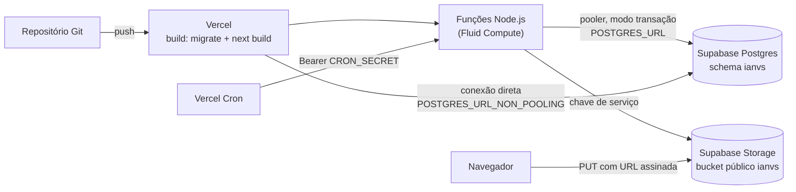

# 08 · Deploy na Vercel

[Início](../README.md) · [Visão](01-visao-do-produto.md) · [Requisitos](02-requisitos-e-historias.md) · [Arquitetura](03-arquitetura.md) · [Dados](04-modelo-de-dados.md) · [Importação](05-importacao-por-planilha.md) · [Fotografia e relevo](06-guia-fotografico-e-relevo.md) · [Manual](07-manual-do-usuario.md) · **Deploy** · [Roadmap](09-roadmap.md) · [Glossário](glossario.md)

---

## Sumário

1. [Visão geral](#1-visão-geral)
2. [Pré-requisitos](#2-pré-requisitos)
3. [Vincular o projeto e conectar o Supabase](#3-vincular-o-projeto-e-conectar-o-supabase)
4. [Banco de dados (Postgres do Supabase)](#4-banco-de-dados-postgres-do-supabase)
5. [Arquivos (Supabase Storage)](#5-arquivos-supabase-storage)
6. [Variáveis de ambiente](#6-variáveis-de-ambiente)
7. [Cron da fila de importação](#7-cron-da-fila-de-importação)
8. [Migrações no build](#8-migrações-no-build)
9. [Publicar](#9-publicar)
10. [Domínio próprio](#10-domínio-próprio)
11. [Checklist pós-deploy](#11-checklist-pós-deploy)
12. [Operação: backup, logs, reversão, pausa do Supabase](#12-operação-backup-logs-reversão-pausa-do-supabase)
13. [Alternativas suportadas pelo código](#13-alternativas-suportadas-pelo-código)

---

## 1. Visão geral



Serviços usados: **Vercel** (hospedagem e funções) e **Supabase** (Postgres e Storage), conectado à Vercel pela integração do Marketplace. Um único provedor de dados.

**Situação em 24/11/2026:**

- o projeto Vercel **`ianvs`** já existe e está conectado ao recurso Supabase **`crm_atrivm`** (região `us-east-2`), mas ainda não teve deploy;
- o banco `crm_atrivm` é **compartilhado com o CRM do ATRIVM**. O IANVS usa só o schema Postgres **`ianvs`** e não toca em nada do schema `public`.

## 2. Pré-requisitos

- Acesso ao *team* da Vercel e à organização Supabase vinculada a ele.
- Vercel CLI: `npm i -g vercel` e `vercel login`.
- Node.js **20.9 ou superior** localmente. No projeto da Vercel, use a versão LTS mais recente disponível (*Settings › General › Node.js Version*).
- Repositório Git (GitHub, GitLab ou Bitbucket) para deploys automáticos a cada *push*.
- Plano Vercel: o **Hobby** funciona, mas o cron roda no máximo uma vez por dia, e o plano é para uso pessoal e não comercial. Para uso institucional e fila automática a cada minuto, avalie o **Pro** (ver [05, seção 10.5](05-importacao-por-planilha.md#105-limites-da-plataforma-vercel)).
- Plano Supabase: no **plano gratuito**, o projeto é **pausado após um período de inatividade** (seção 12.4). Confira os limites de banco, Storage e transferência do plano contratado no painel do Supabase.

## 3. Vincular o projeto e conectar o Supabase

Na raiz do repositório:

```bash
vercel link --project ianvs
vercel integration resource connect crm_atrivm ianvs   # já feito; repita só se desconectar
vercel env pull .env.local
```

- `vercel link` grava `.vercel/` (ignorado pelo Git).
- A conexão do recurso Supabase ao projeto cria as variáveis de banco e de Supabase nos ambientes do projeto (seção 6).
- `vercel env pull` traz essas variáveis para o desenvolvimento local (ver o aviso na seção 6).

O framework Next.js é detectado sozinho. O Fluid Compute vem ativado por padrão em projetos novos.

## 4. Banco de dados (Postgres do Supabase)

Como o IANVS se conecta (código em `src/lib/db/index.ts`):

| Uso | Variável (ordem de prioridade) | Conexão |
|---|---|---|
| **Funções** (em execução) | `DATABASE_URL`, senão `POSTGRES_URL` | Pooler do Supabase em **modo transação**, driver postgres.js (`drizzle-orm/postgres-js`) com `prepare: false`, até 5 conexões por instância, SSL obrigatório |
| **Migrações** (no build) | `DATABASE_URL_UNPOOLED`, senão `POSTGRES_URL_NON_POOLING`, senão `DATABASE_URL`, senão `POSTGRES_URL` | **Conexão direta** (DDL não combina com o pooler em modo transação) |
| **Sem nenhuma URL** | — | PGlite local em `.data/pglite` |

Da URL, o código mantém só os parâmetros `sslmode` e `application_name`.

**Schema isolado.**

- Todas as tabelas ficam em **`ianvs`** (`ianvs.coins`, `ianvs.coin_images`, `ianvs.import_jobs`, `ianvs.import_rows`).
- A tabela de controle das migrações do Drizzle também fica nesse schema.
- A primeira migração cria o schema (`CREATE SCHEMA "ianvs"`).

**Fora da Data API.**

- A Data API (PostgREST) do Supabase expõe, por padrão, o schema `public`. Como `ianvs` não está exposto, as tabelas do IANVS **não são acessíveis** pela API REST do Supabase nem pela chave anônima.
- Todo acesso passa pelo servidor Next.js.
- **Não** adicione `ianvs` aos schemas expostos da Data API.

## 5. Arquivos (Supabase Storage)

- Bucket **público** chamado **`ianvs`**, criado **automaticamente** pelo servidor no primeiro uso, com limite de 50 MB por arquivo. Para usar outro nome, defina `SUPABASE_BUCKET`.
- O bucket é público porque o visualizador, o `iframe` e o CORS do motor 3D precisam ler as fotos sem autenticação. As URLs têm a forma `https://<projeto>.supabase.co/storage/v1/object/public/ianvs/<caminho>`, com sufixo aleatório no nome.
- **Upload direto do navegador**:
  1. o navegador envia `POST /api/upload` com JSON `{ pathname }` (rota só para administradores);
  2. o servidor gera uma **URL de upload assinada** (`createSignedUploadUrl`) com a chave de serviço;
  3. o navegador faz `PUT` do arquivo direto no Storage.

  O arquivo não passa pela função, o que contorna o limite de 4,5 MB de corpo da Vercel.
- Gravação pelo servidor (fotos baixadas por URL na importação) e exclusão usam `SUPABASE_SERVICE_ROLE_KEY` (ou `SUPABASE_SECRET_KEY`). Essa chave **nunca** vai ao navegador.

## 6. Variáveis de ambiente

| Variável | Origem | Uso no IANVS |
|---|---|---|
| `POSTGRES_URL` | Integração Supabase | Conexão das funções (pooler, modo transação) |
| `POSTGRES_URL_NON_POOLING` | Integração Supabase | Conexão direta das migrações no build |
| `SUPABASE_URL` | Integração Supabase | Endereço do projeto (Storage) |
| `SUPABASE_SERVICE_ROLE_KEY` | Integração Supabase | Chave de serviço do Storage (só no servidor). Alternativa: `SUPABASE_SECRET_KEY` |
| `NEXT_PUBLIC_SUPABASE_URL`, `NEXT_PUBLIC_SUPABASE_ANON_KEY` | Integração Supabase | Criadas pela integração; **não usadas** pelo IANVS hoje (o navegador não fala com o Supabase, exceto pelo PUT na URL assinada) |
| `SUPABASE_BUCKET` | Manual, opcional | Nome do bucket (padrão `ianvs`) |
| `DATABASE_URL` | Manual, opcional | Se definida, **tem prioridade** sobre `POSTGRES_URL` (qualquer Postgres) |
| `ADMIN_PASSWORD` | Manual, **obrigatória em produção** | Senha de administrador. Sem ela, qualquer pessoa edita |
| `CRON_SECRET` | Manual, **obrigatória para o cron** | Autentica o cron. Sem ela, `/api/cron/**` exige login de administrador, e o cron da Vercel não consegue entrar |
| `IMPORT_RATE_PER_MIN` | Manual, opcional | Limite global da fila (padrão 10) |
| `BLOB_READ_WRITE_TOKEN` | Opcional | Só se não houver Supabase (seção 13) |

A integração cria ainda outras variáveis (por exemplo, `POSTGRES_PRISMA_URL`, `POSTGRES_USER`, `POSTGRES_PASSWORD`, `SUPABASE_JWT_SECRET`), que o IANVS não usa.

```bash
openssl rand -hex 32                     # gere o CRON_SECRET
vercel env add CRON_SECRET production
vercel env add ADMIN_PASSWORD production
vercel env add ADMIN_PASSWORD preview
vercel env ls                            # confira
```

Use uma senha de administrador longa (frase de 5 ou mais palavras) e compartilhe-a só com a equipe. Trocar a senha encerra todas as sessões abertas. Alterações de variáveis só valem no **próximo deploy**.

> **Cuidado com `.env.local`.**
> - Com as variáveis puxadas, o `npm run dev` local usa **o mesmo banco e o mesmo bucket** do projeto Supabase, ou seja, **altera dados reais** (e roda no mesmo banco do CRM, embora em outro schema).
> - Para desenvolver sem risco, apague ou renomeie `.env.local`: o projeto volta a usar PGlite e disco local.
> - Previews de deploy também usam o mesmo projeto Supabase, salvo se for configurado outro.

## 7. Cron da fila de importação

O cron é a **reserva** da fila: processa lotes quando ninguém está com `/importar` aberta. A rota é `GET /api/cron/imports`.

- Com `CRON_SECRET` definida no projeto, a Vercel envia automaticamente `Authorization: Bearer <CRON_SECRET>`, e o `proxy.ts` aceita a chamada.
- Sem `CRON_SECRET`, a rota exige sessão de administrador.

Crie `vercel.json` na raiz (o arquivo ainda não existe no repositório).

**Plano Pro** (a cada minuto):

```json
{
  "crons": [{ "path": "/api/cron/imports", "schedule": "* * * * *" }]
}
```

**Plano Hobby** (uma vez por dia; horário em UTC, com precisão de até uma hora):

```json
{
  "crons": [{ "path": "/api/cron/imports", "schedule": "0 6 * * *" }]
}
```

Cada execução processa no máximo `IMPORT_RATE_PER_MIN` linhas. No Hobby isso dá ≈ 10 moedas por dia, o que só serve para não deixar o lote parado.

Teste manual:

```bash
curl -H "Authorization: Bearer $CRON_SECRET" https://SEU-DOMINIO/api/cron/imports
```

## 8. Migrações no build

O script `build` do `package.json` é:

```bash
node scripts/migrate.mjs && next build
```

- `scripts/migrate.mjs` aplica `drizzle/*.sql` no schema `ianvs`, usando a **conexão direta** (seção 4), e registra o controle de migrações também em `ianvs`.
- Sem nenhuma URL de banco, o script não faz nada (dev com PGlite).
- O log do build mostra "[migrate] migrações aplicadas no schema ianvs."

Boas práticas:

- Migrações devem ser **aditivas** (novas colunas e tabelas, com valor padrão) e sempre restritas ao schema `ianvs`: o banco é compartilhado com o CRM.
- Como previews e produção usam o mesmo banco, **um deploy de preview aplica a migração no banco de produção**. Só faça *merge*/*push* de migrações revisadas.
- Reverter um deploy (`vercel rollback`) **não** desfaz migrações.

## 9. Publicar

```bash
vercel          # deploy de preview (URL própria)
vercel --prod   # produção
```

Com o repositório conectado, cada *push* gera um preview e cada *merge* no ramo principal, um deploy de produção.

## 10. Domínio próprio

```bash
vercel domains add ianvs.exemplo.ufms.br
```

- Também pode ser feito pelo painel, em *Settings › Domains › Add*.
- A Vercel mostra o registro DNS a criar (em geral um **CNAME** para subdomínios). Para um subdomínio institucional, peça à TI responsável pelo DNS que crie o registro.
- O certificado HTTPS é emitido automaticamente.
- Depois de definir o domínio, atualize os trechos de incorporação (`/embed/...`) já divulgados.

## 11. Checklist pós-deploy

**Configuração**

- [ ] `GET /api/config` responde `"storage": "supabase"`, `"database": "postgres"`, `"auth": true`
- [ ] Log do build mostra "[migrate] migrações aplicadas no schema ianvs."
- [ ] No Supabase, o schema `ianvs` tem as 4 tabelas e o schema `public` do CRM não mudou
- [ ] O bucket `ianvs` existe e é público (é criado no primeiro upload)
- [ ] `ADMIN_PASSWORD` e `CRON_SECRET` definidas em produção (e `ADMIN_PASSWORD` em preview)

**Segurança**

- [ ] Sem login, `/estudio/qualquer` redireciona para `/entrar?next=...`
- [ ] Sem login, `POST /api/coins` e `POST /api/upload` respondem 401
- [ ] Sem cabeçalho, `GET /api/cron/imports` responde 401
- [ ] O schema `ianvs` **não** está entre os schemas expostos da Data API do Supabase
- [ ] `SUPABASE_SERVICE_ROLE_KEY` não aparece em nenhuma variável `NEXT_PUBLIC_*`
- [ ] Regra de limite de taxa no Vercel Firewall para `POST /api/auth`
- [ ] Decidido se `/api/export/**` e a leitura de rascunhos pela API devem ficar públicos (ver [03, seção 7.2](03-arquitetura.md#72-limitações-conhecidas-e-mitigações))

**Funcionalidades**

- [ ] Login funciona e persiste após recarregar
- [ ] Criar moeda, enviar foto de **mais de 4,5 MB** (testa o upload por URL assinada), ajustar, salvar
- [ ] Excluir uma imagem remove o arquivo do bucket
- [ ] Relevo Estimado e Fotométrico renderizam; disco de luz responde
- [ ] `.glb` baixado abre no Blender com o diâmetro certo (por exemplo, 0,0188 m)
- [ ] `GET /api/imports/template` baixa o modelo
- [ ] Importar [`exemplos/planilha-exemplo.csv`](exemplos/planilha-exemplo.csv) com fotos de teste; a fila avança e termina
- [ ] Cron manual (seção 7) responde com `{ jobs, results }`
- [ ] Exportar acervo gera ZIP; reimportá-lo recria as moedas
- [ ] `/embed/[id]` funciona dentro de um `iframe` numa página externa
- [ ] Moeda em rascunho não aparece no acervo público

## 12. Operação: backup, logs, reversão, pausa do Supabase

### 12.1 Backup

- **Banco:** os backups dependem do plano Supabase (confira no painel). Como o banco é compartilhado com o CRM, uma restauração do projeto inteiro afeta os dois sistemas. Para restaurar só o IANVS, mantenha exportações próprias: **Exportar acervo** (ZIP) e `catalog.json`, periodicamente.
- **Arquivos:** não conte com cópia automática do Storage. A exportação periódica do acervo em ZIP é o backup das fotos; guarde-a no repositório institucional.

### 12.2 Logs

- Vercel: `vercel logs <url-do-deploy>` ou *Observability* no painel.
- Supabase: logs de Postgres e Storage no painel.
- Erros de importação aparecem como `[importação <job>] linha N: ...`.

### 12.3 Reversão

`vercel rollback` volta ao deploy anterior, mas **não** desfaz migrações.

### 12.4 Pausa do Supabase

No plano gratuito, o projeto Supabase é **pausado após inatividade**. Com ele pausado, o banco e o Storage param de responder, e o IANVS fica fora do ar (erros de conexão nas funções e fotos sem carregar).

- **Para restaurar:** painel do Supabase › projeto `crm_atrivm` › *Restore*, ou pela integração/MCP do Supabase. A volta leva alguns minutos.
- **Para evitar:** plano pago, ou uso regular. A pausa afeta também o CRM, que usa o mesmo projeto.

### 12.5 Custos

Acompanhe o uso de funções na Vercel e de banco, Storage e transferência (*egress*) no Supabase. As estimativas de volume estão em [05, seção 10.7](05-importacao-por-planilha.md#107-armazenamento-estimado); confira os limites do plano Supabase contratado.

## 13. Alternativas suportadas pelo código

| Recurso | Ordem de escolha no código |
|---|---|
| Banco | `DATABASE_URL` → `POSTGRES_URL` → PGlite local |
| Arquivos | Supabase Storage (com `SUPABASE_URL` + chave de serviço) → Vercel Blob (com `BLOB_READ_WRITE_TOKEN`) → disco local `.data/files` |

O Vercel Blob continua funcionando como alternativa, com *client upload* via `@vercel/blob/client`, para instalações sem Supabase. Qualquer Postgres serve em `DATABASE_URL`, desde que as migrações rodem com uma conexão que aceite DDL.

---

← [07 · Manual do usuário](07-manual-do-usuario.md) · Próximo: [09 · Roadmap →](09-roadmap.md)
