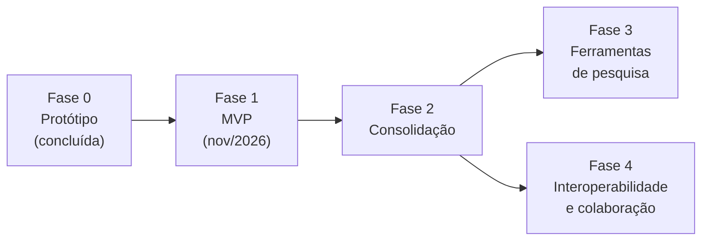

# 09 · Roadmap

[Início](../README.md) · [Visão](01-visao-do-produto.md) · [Requisitos](02-requisitos-e-historias.md) · [Arquitetura](03-arquitetura.md) · [Dados](04-modelo-de-dados.md) · [Importação](05-importacao-por-planilha.md) · [Fotografia e relevo](06-guia-fotografico-e-relevo.md) · [Manual](07-manual-do-usuario.md) · [Deploy](08-deploy-na-vercel.md) · **Roadmap** · [Glossário](glossario.md)

---

## Sumário

1. [Fases](#1-fases)
2. [Fase 0 · Protótipo (concluída)](#2-fase-0--protótipo-concluída)
3. [Fase 1 · MVP (novembro de 2026)](#3-fase-1--mvp-novembro-de-2026)
4. [Fase 2 · Consolidação](#4-fase-2--consolidação)
5. [Fase 3 · Ferramentas de pesquisa](#5-fase-3--ferramentas-de-pesquisa)
6. [Fase 4 · Interoperabilidade e colaboração](#6-fase-4--interoperabilidade-e-colaboração)
7. [Riscos e mitigações](#7-riscos-e-mitigações)
8. [Como propor itens](#8-como-propor-itens)

Situação em 24/11/2026. A ordem dentro de cada fase é a prioridade sugerida; as datas das fases seguintes serão combinadas com a equipe.

---

## 1. Fases

## 2. Fase 0 · Protótipo (concluída)

Página única em three.js r128, com um exemplar (Denário de Augusto, Registro 155933, MHN): recorte circular, contorno por transparência, espessura por peso ÷ densidade, borda procedural, legenda, escala de 1 cm e exportação `.glb`.

## 3. Fase 1 · MVP (novembro de 2026)

| Entrega | Situação em 24/11 |
|---|---|
| Banco (Supabase Postgres, schema `ianvs` / PGlite), armazenamento (Supabase Storage com URL assinada / Blob / disco), migrações no build | Pronto |
| API de moedas, imagens e upload direto | Pronto |
| Senha de administrador e `proxy.ts` | Pronto |
| Motor 3D: geometria, contorno, espessura iterada, borda procedural | Pronto |
| Relevo: Estimado, Fotométrico, Mapa de altura, Desligado; profundidade geométrica | Pronto |
| Janela Ajustar (auto-centralizar, recorte de fundo), disco de luz, palco 3D | Pronto |
| Importação: planilha, fila com limite global, cron, reprocessar, cancelar | Pronto |
| Exportação: `catalog.xlsx`, `catalog.json`, formato do ZIP | Pronto |
| Páginas: acervo, visualizador, incorporação, estúdio, importar, entrar | Em construção |
| Comando de build com migração | Pronto |
| Projeto Vercel `ianvs` conectado ao Supabase `crm_atrivm` | Pronto (sem deploy ainda) |
| `vercel.json` (cron) e primeiro deploy | A fazer |
| Documentação | Esta versão |

## 4. Fase 2 · Consolidação

Ajustes identificados durante a documentação do MVP, que fecham lacunas entre o especificado e o implementado.

| # | Item | Motivo |
|---|---|---|
| 2.1 | **Filtrar rascunhos** na leitura pública da API e proteger ou filtrar `/api/export/**` | ✅ Feito em 24/11/2026 |
| 2.2 | **Negar `/api/cron/**` quando `CRON_SECRET` não existe** | ✅ Feito em 24/11/2026 |
| 2.3 | **Modo de relevo automático na importação**: Fotométrico se houver 3+ fotos de luz, Mapa se houver mapa | ✅ Feito em 24/11/2026 |
| 2.4 | **Restaurar `params` a partir de `metadados.json`** na reimportação | Completa a ida e volta (ajustes do estúdio) |
| 2.5 | **Miniaturas** para moedas importadas | A grade do acervo precisa de `thumb_url` |
| 2.6 | **Cache de relevo e fotos reduzidas** para o visualizador público: guardar mapa de altura/normais calculado e versões menores das fotos | Hoje o modo Fotométrico obriga o visitante a baixar todas as fotos de luz (ver [05, 10.7](05-importacao-por-planilha.md#107-armazenamento-estimado)) |
| 2.7 | **Escala absoluta** para mapas de altura (usar a profundidade do arquivo em vez de normalizar) | Preserva a métrica de scanners |
| 2.8 | **Campos de diâmetro mínimo e máximo** | Flans irregulares; hoje a faixa vai em observações |
| 2.9 | Leitura opcional do **azimute pelo nome do arquivo** (`…_luz090.jpg`) | Menos digitação na planilha |
| 2.10 | Validação de SSRF com **resolução de DNS** e verificação de redirecionamentos | Endurecimento da importação por URL |
| 2.11 | Cabeçalho `frame-ancestors` liberado só em `/embed/**` | Proteção contra *clickjacking* |
| 2.12 | **Limpeza de arquivos órfãos** no bucket do Storage (envios não registrados) | Custo de armazenamento |
| 2.13 | Limite de taxa em `POST /api/auth` | Força bruta |
| 2.14 | Testes automatizados (interpretação de planilha, fila, geometria) e acessibilidade por teclado | Qualidade |
| 2.15 | Indicação na ficha pública de **o que é estimado ou procedural** (espessura, borda, origem do relevo) | Princípio de fidelidade |
| 2.16 | ~~Restringir tipos de arquivo no bucket~~ (feito: `allowedMimeTypes: ["image/*"]` na criação do bucket) e avaliar **usuário Postgres com permissão só no schema `ianvs`** | O banco é compartilhado com o CRM |

## 5. Fase 3 · Ferramentas de pesquisa

| Item | Descrição |
|---|---|
| **RTI completo (PTM/HSH)** | Ajustar por pixel *Polynomial Texture Maps* ou *Hemispherical Harmonics* às fotos de luz; reiluminação de qualquer direção sem depender da integração em altura; realces clássicos (*specular enhancement*, *unsharp masking* de normais). Importar e exportar arquivos `.ptm` e `.rti` |
| **Comparação lado a lado de cunhos** | Duas ou mais moedas no mesmo enquadramento, com alinhamento (rotação e escala), sobreposição com transparência e diferença, para estudos de ligação de cunhos |
| **Anotações sobre o modelo** | Marcadores ancorados na superfície 3D (letra da legenda, contramarca, defeito de cunho), com texto, autor e data; visíveis no visualizador público quando marcados como públicos |
| **Medidas virtuais** | Régua e transferidor sobre o modelo (diâmetros em vários eixos, distância entre letras) |
| **OCR assistido de legendas** | Sugestão de leitura da legenda a partir do relevo com luz rasante, **sempre como proposta** a ser confirmada pelo pesquisador |
| **Estatísticas do acervo** | Distribuição de pesos e diâmetros por denominação e autoridade; histogramas de eixo |
| **Calibração de luz por esfera** | Detectar a direção da luz a partir de uma esfera reflexiva no quadro (como no *Highlight RTI*), dispensando o registro manual do azimute |

## 6. Fase 4 · Interoperabilidade e colaboração

| Item | Descrição |
|---|---|
| **Multiusuário com papéis** | Contas individuais (por exemplo, administrador, curador, pesquisador, convidado), com permissões por acervo; registro de quem alterou o quê |
| **Histórico de versões** | Versões da ficha e dos ajustes, com comparação e restauração |
| **Nomisma.org** | Vincular casa monetária, denominação, autoridade e material a URIs do Nomisma; exportar dados abertos (RDF/JSON-LD) para agregadores numismáticos |
| **IIIF** | Servir as fotos pela IIIF Image API e publicar manifestos da Presentation API (incluindo, quando estável, a extensão 3D), para uso em visualizadores e bibliotecas digitais |
| **Identificadores persistentes** | Permalinks estáveis por registro e, se a instituição desejar, DOI por moeda ou coleção |
| **Integração com sistemas de gestão de acervo** | Importação e sincronização com o sistema do museu parceiro, além da planilha |
| **Internacionalização** | Interface em inglês e espanhol para pesquisadores estrangeiros |

## 7. Riscos e mitigações

| # | Risco | Prob. | Impacto | Mitigação |
|---|---|---|---|---|
| R1 | Relevo **Estimado** ser tomado como medida em publicações | Média | Alto | Rótulo obrigatório no visualizador e na ficha; exportações carregam a origem do relevo; guia fotográfico incentiva o Fotométrico |
| R2 | Profundidade em mm escolhida à mão ser lida como medida | Média | Médio | Documentado ([06, 6.2](06-guia-fotografico-e-relevo.md#62-o-que-a-profundidade-significa)); item 2.7; campo "profundidade medida" na ficha |
| R3 | Prata especular gerar relevo fotométrico ruim | Alta | Médio | Protocolo com 8 fotos e luz difusa; descarte de extremos já implementado; polarização cruzada; RTI na Fase 3 |
| R4 | Importação lenta por servidores de origem | Média | Médio | Preferir ZIP; limite configurável; reprocessar erros; lote-piloto ([05, 10.9](05-importacao-por-planilha.md#109-recomendação-final)) |
| R5 | Cron limitado no plano Hobby | Alta (no Hobby) | Baixo | Fila dirigida pela página; plano Pro para lotes sem supervisão |
| R6 | Armazenamento e transferência do Supabase Storage crescerem com fotos de luz e excederem o plano (compartilhado com o CRM) | Média | Médio | Estimativas em [05, 10.7](05-importacao-por-planilha.md#107-armazenamento-estimado); item 2.6 (cache e fotos reduzidas); acompanhamento mensal |
| R7 | Exposição de rascunhos e observações internas pela API | Alta (hoje) | Médio | Item 2.1 antes da divulgação pública |
| R8 | Senha única vazada | Baixa | Alto | Senha longa, troca periódica, limite de taxa (2.13); contas individuais na Fase 4 |
| R9 | Direitos de imagem das fotos de acervos parceiros | Média | Alto | Acordo com a instituição antes de publicar; campo de crédito e licença na ficha (proposta); bucket público só para o que pode ser público |
| R10 | Perda de dados (sem cópia automática do Storage; restauração do banco afeta também o CRM) | Baixa | Alto | Exportação periódica do acervo em ZIP e de `catalog.json`; backups conforme o plano Supabase |
| R11 | Desempenho em computadores modestos (estéreo com 8 fotos, malha densa) | Média | Médio | Resolução adaptativa do relevo e da malha; cache de relevo (2.6) |
| R12 | Mudanças de API no Next.js 16 e no ecossistema | Média | Baixo | Seguir a documentação da versão instalada; testes automatizados (2.14) |
| R13 | ZIPs grandes demais para a memória do navegador | Média | Médio | Recomendação de ZIPs até ~1–2 GB ou seleção de pasta ([05, 10.6](05-importacao-por-planilha.md#106-envio-dos-arquivos-pelo-navegador-lotes-em-zip)) |
| R14 | Dependência de fornecedores (Vercel, Supabase) | Baixa | Médio | Formatos abertos, exportação completa reimportável, Postgres padrão (`DATABASE_URL`), Vercel Blob e disco como alternativas no código |
| R15 | **Pausa do projeto Supabase por inatividade** (plano gratuito) deixar o IANVS e o CRM fora do ar | Média | Alto | Restaurar pelo painel ou pela integração; monitorar disponibilidade; plano pago para uso público |
| R16 | **Banco compartilhado com o CRM**: migração, carga da importação ou chave de serviço vazada afetarem o CRM | Baixa | Alto | Schema `ianvs` isolado e fora da Data API; migrações revisadas; chave de serviço só no servidor; limite de taxa da fila; avaliar projeto Supabase próprio se o uso crescer |

## 8. Como propor itens

Abra uma *issue* no repositório com: problema (quem é afetado e como), proposta, critério de aceite no formato Dado/Quando/Então e prioridade sugerida (MoSCoW). Itens aceitos entram neste documento e em [02 · Requisitos](02-requisitos-e-historias.md).

---

← [08 · Deploy na Vercel](08-deploy-na-vercel.md) · [Glossário →](glossario.md)
